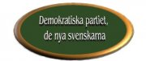
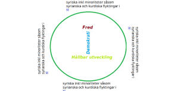

\[caption id="attachment\_5" align="aligncenter" width="180"\][](http://investeringsprojektforflyktingar.wordpress.com/2012/06/29/bekanta-dig-med-de-nya-svenskarna/dpns/) De Svenska partiernas Rötter.\[/caption\]

**Miljömodellen för demokratin , demokratin från terori till praktik med Multireligionvalsystem som grund.**

       **_**FRED**_   _**villar  på**_    _**MULTIRELIGIONVALSYSTEM**_**

**Det finns nämligen ett starkt filosofiskt samband mellan fred – demokrati och hållbar utveckling , dessa utgör grunden för en stark grön Infrastruktur. Detta bygger på en enkel solidarisk modell för tagande av initiativ som kan rädda liv, minska lidande , skapa fred , demokrati vilket grundar sig på multireligionvalsystemet och leder till hållbar utveckling.**

```
En enkel solidarisk modell för tagande av initiativ kan rädda liv, minska lidande , skapa fred , demokrati och en hållbar utveckling.

I tur och ordning kallar varje partiordförande de medlemmar som har sina rötter i ett land där krig pågår eller där oroligheter eller konflikter med grannländer eller minoritetsgrupper pågår.

Partiordföranden för Moderataterna ska börja med att kalla endast de syriska flyktingar vilka är bosatta i Sverige och som är medlemmar eller sympatiserar med Moderaterna till en öppen dialog.

Processen tillämpas på samma sätt med andra flyktingar som är medlemmar i övriga  partier.

1) Riksdagspartier: M, Fp, C och Kd , S , V och Mp.

2) Flyktingar : Syrier, Egyptier , Somalier, 
             Afghaner, Jemniter, Irakier, 
              palestinier , judar, nigerianer

* ccTLD , avser ländernas domainer motsvarande den 
          svenska .SE
```

\[caption id="attachment\_6" align="aligncenter" width="300"\][](http://investeringsprojektforflyktingar.wordpress.com/2012/06/29/bekanta-dig-med-de-nya-svenskarna/syr-m/) träna samarbete och att kompromissa\[/caption\]

```
De syriska flyktingar i Sverige som tillhör M är överens om dess politik vad gäller  fred, demokrati och hållbar utveckling. Vi utgår därför ifrån att M är ett parti som fortlöpande lär s sina medlemmar att tillämpa politiska kompromisser när det gäller att lösa konflikter verka för demokrati och arbeta med miljöfrågor och inte bara dela ut valsedlar och värva medlemmar pga stamtillhörighet.

I fall M misslyckas med denna process när det gäller syriska flyktingar kan man i  alla fall arbeta vidare med dessa parallellt med andra grupper.
```

**Fred -Demokrati – Hållbar utveckling är tre grundpelare som vårt parti , De Nya Svenskarna , vilar på**.

Du som medlem måste utbilda dig i och följa dessa i dina politiska uppdrag . Krigslagarna , konfliktlösning , f**redspristagare** och varför internationella freds & miljöavtal inte följas ,

Läs om varför Varför flyr folk från sina länder b la på [http://refugee.wordpress.com/](http://refugee.wordpress.com/)

**Miljömodellen för demokrati, demokrati från teori till praktik .**

```
Att komma överens om demokratins fem grundpelare , Införa de i FN:s stadgar ,EU fördraget och i varje lands konstitution , lära ut dessa i skolorna så att alla vet om att demokratin har en enligt definition med fem grundpelare.
De Nya svenskarna menar att på samma sätt som judar och kristna känner till tio Guds bud och muslimerna de fem bud och mantra hos buddisterna som också lärs ut i skolorna borde de kunna genomföra detta med ämnet :
” Miljömodellen för demokrati, demokrati från teori till praktik”.

1) Maktdelningsprincip, man skiljer mellan lagstiftare som parlament, verkställande  som regeringar och dömande som domstolar och ingen få r påverka eller ändra deras  domar eller beslut.

2) Allmänna val kompletteras med folkomröstning

3) Fri partibildning med partistöd så att partierna inte få anonyma bidrag som   påverkar deras politik, dvs det parti som får de procent som berättigar det till riksdagsmandat får partistöd. Fri press som får presstöd så att den inte blir   påverkad av någon anonym sida som kan påverka tidningarnas innehåll.

4) Religionsfrihet som också innebär att om en kristen bygger en kyrka skall  buddisten ha rätt att bygga ett tempel , juden bygga en synagoga och muslimen   en moske.

5) Yttrandefrihet 
```

Detta kompletteras med att läsa boken **, De Svenska partiernas Rötter.**

**Boken är ännu ej färdigtryckt**

### Arbetsmarknadspolitik, arbetslösheten bland invandrare, analys och lösningar

**Investeringsprojekt i en grön infrastraktur**

**u-ländernas topdomain och I-ländernas topdomain**

**ccTLD topdomain innan diktatorerna faller och ccTLD efter diktatorernas fall mha av I-länderna**

**Varje u-land har trots fattigdom en stor potential av resurser , teknisk kunskap och människor och naturresurser i form av solenergi som kan utnyttjas för att driva sin egen top-domain .**

**Investerings projektet kan också sysselsätta hundratals flyktingar som kommer från u-länderna och bor i Sverige, det gynnar både u-ländernas och den svenska ekonomin .**

**Släpp u-länderrnas topdomäner fria och demokratisera u-ländernas internet.**

**U-ländernas folk har faktiskt rätt till sin egen internationella topdomän , såsom USA= .us , Storbritannien = .uk , Tyskland= .de , frankike =. fr och Sverige =se.**

**Om Sverige driver ett annats lands topdomain hur kommer det sig då att vi som är flyktingar och bor i Sverige inte har rätt att driva vår egen domain härifrån.**

**Sveriges bistånd till u-länderna delas i två delar, en del skickas till u-landet och hälften stannar kvar i Sverige så att de flyktingar som kommer från u-landet kan driva sitt lands topdomain , starta bolag och anställa många invandrare och även svenskar.**

**Vi vet till hundra procent hur halva biståndet används , vi har kontroll över det. Sverige får skatteinkomster och arbetslösheten går ned bland invandrare och även bland svenskar .**

**Under diktatorernas regim utnyttjades berörda länders ccTLd domän endast av ett fåtal , den var registrerad av ett statligt bolag och släpptes aldrig fri , medborgarna har inte fått möjlighet att registrera domain direkt under landets top-domainen så att medborgarna lätt kan hitta de partier som deltar i valet och att de ska kunna kommunicera med dessa genom e-mail osv. I jämförelse med svenska partiorganisationer .se**

**Samma ska när det gällar deras press såsom tidningar, bolag och idrottsklubbar och andra institutioner , industrier mfl.**

**Efter diktatorernas fall och i början av återuppbyggnaden bör de i-länder som bidrar med bistånd se till att man investerar i en grön infrastruktur , släppa topdomainen fri och demokratisera internet så att alla har tillgång till det på samma sätt som när man skickar valobservatörer och valövervakare som skall se till att medborgarna ges lika möjlighet att utöva sin rösträtt i fria och rättvisa val och vid folkomröstning, dessutom ge internationell legitimitet att dessa val sker med det övergripande syftet att främja en politisk process i riktning mot en demokratisk utveckling,**

**EU\*, med sin s k mjuka makt , OSSE och ODIHR organisationerna för demokratiska institutioner och MR.**

**Men den valda regeringen och parlamentet tog inte itu med problemet utan i stället delegerade de bara till ett annat statligt bolag , här nedan ett typisk exempel där svenska regeringen bidrog med sex miljardar kronor i bistånd**

**T****rots många skrivelser , påpekanden och e-mail, svarade aldrig det bolag vilket man delegerat domänen till .**

**Det har visat sig att syftet med de här bolagen främst har varit att tjäna pengar och att därför bara de bättre ställda fått tillgång till Internet genom dessa bolag. Dessa bolag är heller inte intresserade av att få tillgång till domänen .iq .**

**Demokratisering av Internet kan bidra till fred och bättre ekonomi**

**Syftet**

1. **att få igång u-ländernas top domänen**
    
2. **att internet ska vara tillgängligt för alla medborgare , alla ska få möjlighet att skaffa det till ett rimligt pris**
    
3. **Demokratisering av Internet med en fri ccTLD**
    
4. **att ungdomarna blir mer engagerade och därigenom avhåller sig från våld och det slutliga resultatet blir fred.**
    
5. **Utnyttja Internet i valet**
    
6. **att skapa arbetstillfällen, en bra investering som stärker u-ländernas ekonomi och landets infrastruktur**
    
7. **Sysselsätta många flyktingar vilket också gynnar svensk ekonomi**
    
8. **Detta begränsar de icke demokratiska dominerande utländska Internet bolagen**
    

**Mot denna bakgrund och med analys av problemen och syftet kom vi fram till följande lösningar.**

**På samma sätt som Sverige driver Söderhavsöarnas domän , .ST borda också kunna driva de de u-ländernas top domänen utifrån, nämligen från Sverige. I Sverige finns bra förutsättningar för att utveckla u-ländernas internet.**

**Genom att få del av det bistånd som är öronmärkt till återuppbyggnad av u-ländernas infrastruktur, demokrati m.m kan vi driva projektet naturligtvis i samarbete med svensk expertis på dessa områden.**

**Demokratiseringen av u.länderna skulle också innebära en demokratisering av Internet och informationsfrihet , u-länderna har rätt till att fritt utbyta information på samma sätt som bl a amrikanerna.**

**Varken u-ländernas ambassader i Sverige eller deras regeringar, ej heller parlamenten eller dess partier har egna hemsida registrerat under deras lands topdomäner , ej heller pressen och industrin har egen top-domain .**

_**Har man kämpat hårt för att upphäva den ekonomiska sanktionen så ska man också kunna släppa top-domainen fri.**_

_De Nya Svenskarna har därför två mål , dels att vi som har varit i Sverige en längre tid genom solidaritet och samarbete vill skriva en positiv historia i detta land , denna positiva historia skall överföras till nästa invandrargeneration så att den i sin tur bygger vidare på den. Syftet är att undvika att tillfoga nästa generation skada. Dels att genom solidaritet och samarbete undvika att de som söker asyl efter oss inte drabbas pga av våra misstag och vår splittring. Solidaritet med nästa generation, se vidare " integrationsinfrastruktur"_

_**Solidaritet utgör en grund i en hållbar utveckling , med människor , djur och natur** , men **de främlingsfientliga partierna i Europa har visat att de är mot hållbar utveckling**_

De Nya Svenskarna utgår från principen om att: alla människor har lika värde och rättigheter , FN:s konvention om det mänskliga rättigheterna,

_Alla är välkomna som medlemmar i De Nya Svenskarna, , ingen mobbning eller diskriminering får förekomma . Som medlem måste du verka för det bla genom att ge stöd till alla minoriteter i Sverige . I denna ingår jämställdhet och barns rättigheter enligt Barnkonventionen,_

solidaritet

_De Ny Svenskarna_

_\_\_\_\_\_\_\_\_\_\_\_\_\_\_\_\_\_\_\_\_\_\_\_\_\_\_\_\_\_\_\_\_\_\_\_\_\_\_\_\_\_\_\_\_\_\_\_\_\_\_\_\_\__

[www.multireligionval.info](http://multireligionvalsystem.dpns.se)     [fa](<facebook.com/denyasvenskarna > "De Nya Svenskarna ")[cebook.com/denya**svenskarna**](<facebook.com/denyasvenskarna > "De Nya Svenskarna ")     [](<facebook.com/denyasvenskarna > "De Nya Svenskarna ")   [@dpns](https://twitter.com/dpns "De Nya Svenskarna")     [www.dpns.se](http://www.dpns.se)
