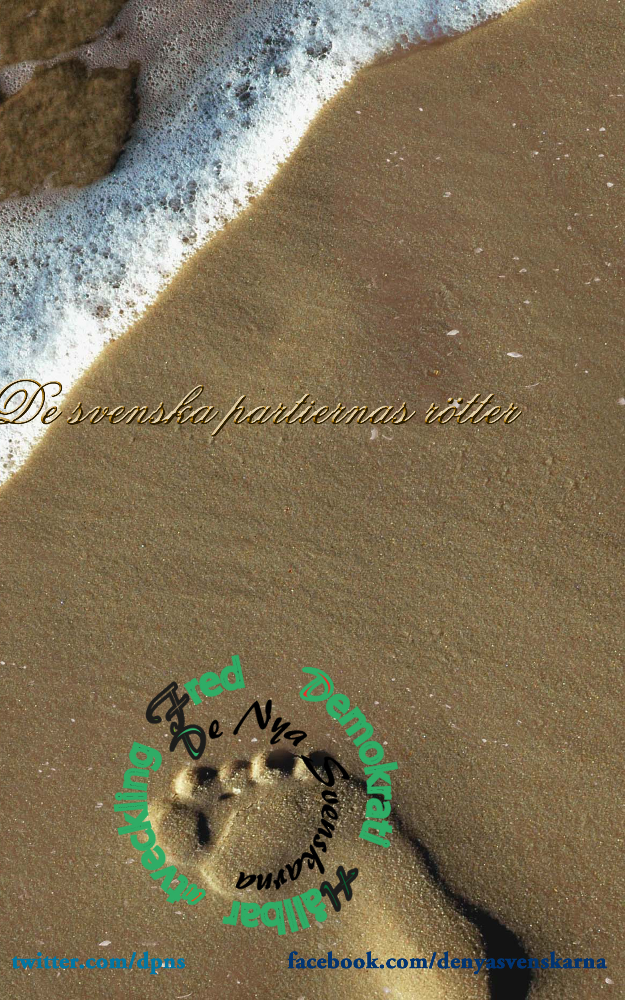

لديمقراطي من النظيرة للتطبيق , النموذج البيئي للديمقراطية

عناصر الديمقراطي الخمس

يجب التوحيد حول الفهم العلمي للديمقراطية

   **انتخابات عامة مباشرة حرة وسرية , شرط أن تعزز**

عملياَ ان تكون الانتخابات مبنية على أسساسين , اولهما عامة حيث يزود أي لمواطن بلغ السن القانوني ومن ادارة سلطة الانتخابات في بلده بظرف مغلق يثبت من خلاله حق المواطن المؤهل للتصويت الى مثلا البرلمان , محالس المحافظات و البلديات , بالاضافة الى المكان الذي سوف يدلي بصوته هناك كالمدارس والمؤسسات الرياضة وعيرها حتى في اماكن مثل روضة الاطفال . تطبع تلك مجانا ونوزع مجانا من احد حقوق المواطن و المواطنة , ان لم يحصل المعني على ذلك الظرف عليه الاتصال بالجهة المعنية . ثانياَ سريه أي لم يعرق أي شخص اخر عن الحزب التي ادليت بصوتك له .

تعزز تلك من خلال اللحوء الى وسيلة ديمقراطية اخرى غير مباشرة وهي الاستفتاء الشعبي

.

  **حرية الاحزاب وتعددها , تعزز**

تفرض الديمقراطية تعدد الاحزاب , وان كل حزب يحصل على نسبة معينة في الانتخابات حسب قانون الانتخابات يحصل على

مقاعد في البرلمان , مشاركة القوائم الانتخابية غير مقبولة وانما تخرخ الاحزاب في الانتخابات كل حزب له برنامج انتخابي خاص

به . عندما نتكلم عن التحالفات فقيصد بها برنامج يتفق عليه حزبين او اكثر على تكوين حكومة بعد الانتخابات اذا فاز هؤلاء

المتفقين في الانتخابابات أي عند حصولهم على اغلب الاصوات .

تعزز تلك من خلال المساعدة الحزبية , أي تدفع من ميزانية الدولة المالية نسبة معينة لكل حزب حصل على النسبة التي يفرضها

القانون التي تؤهله لدخول البرلمان . السبب تجنب تلك الاحزاب من الحصول على مساعدات من جهات مجهولة تؤثر على محتوى

سياستها .

تعزز أيضاَ من خلال وجود معارضة قوية .

تعزز النقطة الاولى من خلال بديهية وهي كلما ارتفعت نسبة الذين يدلون باصواتهم كلما عززت الديمقراطية , على الاقل 90

بالمائة من الشعب المؤهل للتصويت يدلي باصواتهم حتى وان ص2وت على الابيض , بلانك .

  **تعدد الصحف وحريتها وحرية نشر الافكار والتعبير**

تعزز تلك من خلال المساعدة الصحفية , أي تدفع من ميزانية الدولة المالية نسبة معينة لكل صحيفة , جريدة لها نسبة اصدار

يفرضها القانون على النسبة مالية معينة , السبب تجنب تلك الصحف من الحصول على مساعدات من جهات مجهولة وبالتالي تؤثر

على محتوى النشر

.

  [**حرية الاديان في ممارسة نشاطه**](http://solidarity.webblogg.se/2013/august/kyrkovalet.html "konflikter och inbördeskrig ")ا ,

تعزز اذا بنى المسلم مسجد فمن حق الاديان الاخرى بنائاء معابد او كنائس او مشابه ذلك

.

  **مبدأ توزيع السلطة , البرلمان , الحكومة والقضاء**

عزل تلك السلطات عن بعضها البعض

البرلمان هو منتخب من قبل الشعب لهذا يقال بان الشعب يقود السلطة عن طريق ممثليه السياسيين , حسب الاصطلاح الاغريقي ,

ديمو وكرات أي الشعب يقود . البرلمان هو السلطة التشريعية الوحيدة , يشرع القوانين . البرلمان ينتخب رئيس وزراء الذي بدوره يكون الحكومة من الوزراء

الحكومة , سلطة تنفيذية أي تنفذ مايقرره البرلمان

سلطة الوزير , لايحق للوزير التدخل في وزارة اخرى غير وزارته او تغير حكم او قرار

.

تعزز تلك العناصر الخمس بوجود دستور يضمن تلك الحقوق .
