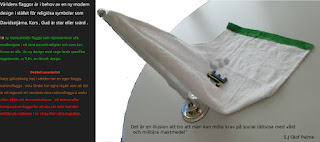

**Regrets the sadness that Sweden has now abandoned its neutrality and nonalignment.**

**Regrets the sadness the sadness that Sweden has now abandoned its role as a mediator in wars and conflicts!**

**Regrets the sadness that Sweden has now abandoned Swedish values, weakened democracy and killed the opposition!**

**Regrets the sadness the NATO countries, Sweden and Norway who are awarding the Nobel Prize from Oslo and Stockholm. This is in violation of Nobel's will.**

**Had Nobel known that Norway and Sweden would join NATO, he would have bequeathed it to Switzerland.**

**Without a public open debate, without a prior referendum, without opposition and without a unity government, that is how Sweden has been drawn into the military alliance, NATO!**

**This is evidenced by unreliable politicians who first said NO to NATO but then changed their minds and became yes-men!**

**The fact that Sweden was drawn into the military alliance NATO is also the mistake of the journalists, political commentators and reporters, who have been passive. Had they engaged properly in presenting facts, views, examined and asked questions to all party leaders and interviewed people instead of the lobbyists, PR people and LO who have been given a significant role.**

**Instead of forming a coalition government, the Social Democrats together with the Tidö parties formed a so-called SSD government that has put an end to solidarity with other peoples!**

**Regrets the sadness that Sweden has turned to NATO instead of the UN and its peacekeepers**

**[Warposes a threat to the environment and humanity](https://multireligionvalsystem.eu.org/How-to-solve-a-most-complex-and-controversial-issues-in-the-world/)**
