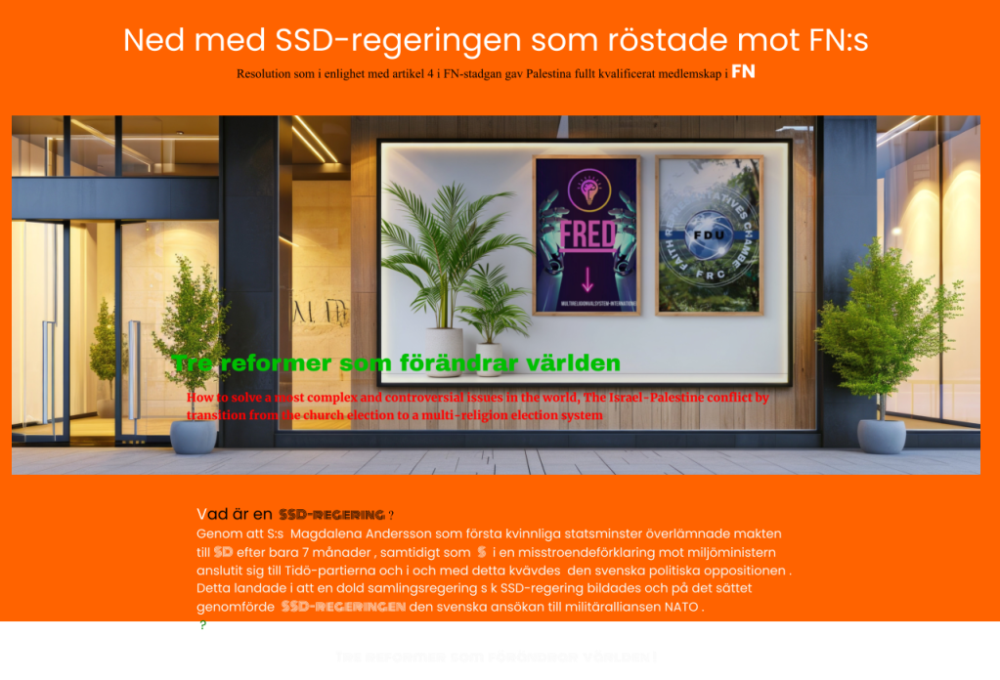

Kungens uppgift i den svenska monarkin.

I kris och krigsfara skall kungen som leder krigsdelegationen träda fram då krigsdelegationen ersätter både riksdagen och regeringen .Riksdagsledamöter och regeringsmedlemmar skall var först med att ställa upp i kriget eftersom de inte har någon sysselsättning .

Kungen är statschef och Kristerson är regeringschef . Kungen leder krigsdelegationen i krig eller vid krigsfara . Kristerson är en medlem i krigsdelegationen . krigsdelegationen består av 10 medlemmar , Kristerson , M, har ett mandat medan SD har två mandat , S har ett mandat, V har ett mandat, KD har ett mandat, C har ett mandat, L har ett mandat och MP har ett mandat .

Varför har SD två mandat som under ståndsriksdagen då kungen hade två röster , utslagsröst.

Nu har en av medlemmarna i krigdelegationen , Kristerson , förra året startat en propagandakampanj, kampanjen om det ryska hotet och krigfaran , Sverige är i djup kris. Kristerson tog med sig Åkesson, Persson och Ebba Bush som stöd . Detta påminner om Borgargårdstalet då kung Gustaf V med stöd av Sven Hedin vilken varnade om det ryska hotet innan första världskriget och började sin kampanj med att samla in pengar till försvaret, militär upprustning och bygget av pansarvagn. Även skolor blev inkopplade på denna kampanj.

Emellertid motsatte sig juristen, advokaten och tillika statsminister liberalen Karl Staaf som ledde två regeringar och var med vid upplösningen av Sverige-Norgeunionen.

Jämför detta med dagens jurister och den svenska ansökan till militäralliansen NATO , neutralitet och alliansfrihet , DCA-avtalet och den amerikanska lagstifting som börjas tillämpas i Sverige . Sverige är under ockupation .

Alla medlemmar i krigsdelegationen var närvarande men inte ordförande, kungen, i partiledaredebatten som handlade om krisen i Sverige och hotet från Ryssland .

I kris och krigsfara ersätter krigsdelegationen och som leds av kungen både riksdagen och regeringen , kungen skall träda fram .

Sverige har ingen opposition , den dolda samlingsregeringen, SSD-regeringen som bildades mellan S och M med stöd av de övriga riksdagspartierna . På det sättet lyckades SSD-regeringen ansöka om svenskt medlemskap till militäralliansen NATO, överge neutraliteten och allian friheten m.m.

Vad är en SSD-regering ?

Genom att S:s Magdalena Andersson som första kvinnliga statsminster överlämnade makten till SD efter bara 7 månader , samtidigt som S i en misstroendeförklaring mot miljöministern anslutit sig till Tidö-partierna och i och med detta kvävdes den svenska politiska oppositionen . Detta landade i att en dold samlingsregering s k SSD-regering bildades och på det sättet genomförde SSD-regeringen den svenska ansökan till militäralliansen NATO .

Är det en Trollfabrik då skall kontrollmakten träda fram eftersom det handlar om högförräderi .

Kontrollmakten kan granska på vilket sätt SSD-regeringen röstade mot FN: resulotionen om Palestinas ökade rättigheter .

Vapenindustrin är en ohållbar industri och därför måste den avvecklas på samma sätt som tobaksindustrin !

Krig utgör ett hot mot miljön och mänskligheten
