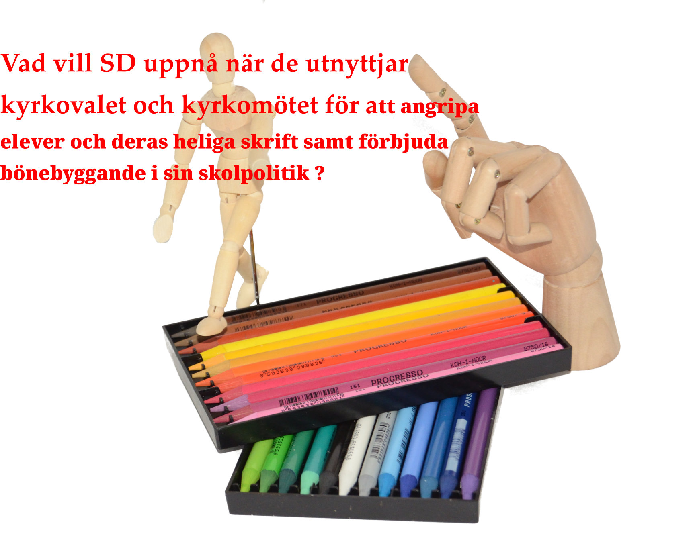

Är det inte skrattretande när Kristersson i Almedalen för första gånger nämnde oppositionen , att han har informerat oppositionen . Fast oppositionen är död och ersatt med en dold samlingsregering under beteckningen SSD-regering ?

Vapenindustrin är en ohållbar industri och därför måste den avvecklas på samma sätt som tobaksindustrin !

Krig utgör ett hot mot miljön och mänskligheten
