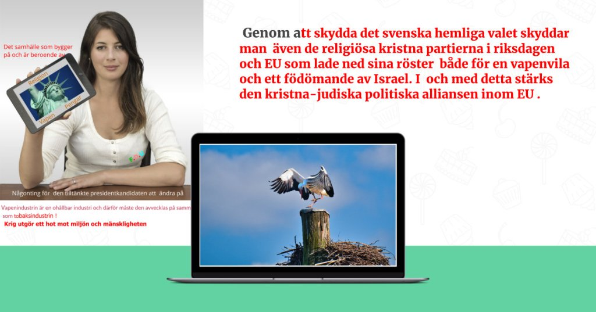
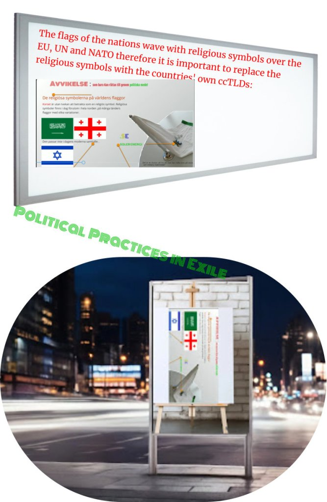

Inte ens talmännen i ståndsriksdagen hade ett sådant privilegium som nuvarande talmänen och statsråd.

Ni vet att talmannen deltar i kyrkomötet , det högsta beslutande organ inom den svenska kyrkan och i och med det är talmannen aktiv inom den svenska kyrkan så även hans parti, M som deltar i kyrkovalet.

Samtidigt exkluderas andra medlemmar inom M tillhörande ett annat trossamfund än ett protestantisk från att delta i kyrkovalet.

Talmanen har skaffat sig ett privilegium som inte talmännen i ståndriksdagen hade två valmöjligheter , rösta eller avtå från att rösta i kyrkovalet . Motsvarande bild hittar man bland annat hos statsrådet, Ebba Bush som har skaffat sig flera privilegier, dubbelt medborgarskap , norskt och svenskt samtidigt som hon tillsammans med SD vill utvisa flyktingar och dessutom har hon två valmöjligheter i kyrkovalet , att rösta eller inte rösta .

Att skydda det hemliga valet , kyrkovalet, sker genom att inte låta riksdagspartierna debattera om detta . Svenska medier talar hellre om det amerikanska valet än det svenska hemliga valet vilket äger rum i sep nästa år. Svensk media flyttar fokus från Israels pågående folkmord i Gaza och bombning av Libanon till det pågående kriget i Ukraina.

Vapenindustrin är en ohållbar industri och därför måste den avvecklas på samma sätt som tobaksindustrin !

**Krig utgör ett hot mot miljön och mänskligheten.**  
  
  
  
  
  
  
  
  
  
  
  

Inte  
ens talmännen i ståndsriksdagen hade ett sådant privilegium som  
nuvarande talmänen och statsråd.  
Ni  
vet att talmannen deltar i kyrkomötet , det högsta beslutande organ  
inom den svenska kyrkan och i och med det är talmannen aktiv inom  
den svenska kyrkan så även hans parti, M som deltar i kyrkovalet.Samtidigt  
exkluderas andra medlemmar inom M tillhörande ett annat trossamfund  
än ett protestantisk från att delta i kyrkovalet.  
Talmanen  
har skaffat sig ett privilegium  
som inte talmännen i ståndriksdagen hade två valmöjligheter ,  
rösta eller avtå från att rösta i kyrkovalet . Motsvarande bild  
hittar man bland annat hos statsrådet, Ebba Bush som har skaffat  
sig flera privilegier,  
dubbelt medborgarskap , norskt och svenskt samtidigt som hon  
tillsammans med SD vill utvisa flyktingar och dessutom har hon två  
valmöjligheter i kyrkovalet , att rösta eller inte rösta .  
Att  
skydda det hemliga valet , kyrkovalet, sker genom att inte låta  
riksdagspartierna debattera om detta . Svenska medier talar hellre om  
det amerikanska valet än det svenska hemliga valet vilket äger rum  
i sep nästa år. Svensk media flyttar fokus från Israels pågående  
folkmord i Gaza och bombning av Libanon till det pågående kriget  
i Ukraina.  
  
Vapenindustrin  
är en ohållbar industri och därför måste den avvecklas på samma  
sätt som tobaksindustrin !

**Krig  
utgör ett hot mot miljön och mänskligheten.**
