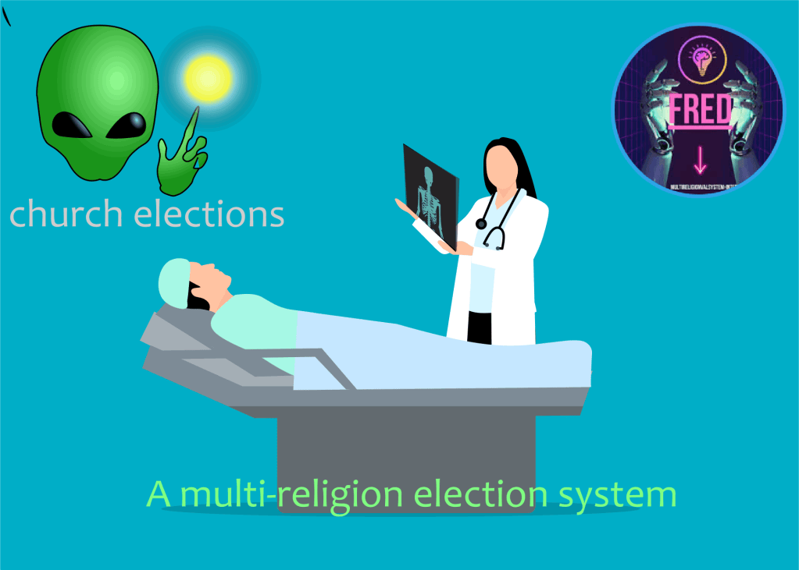

Oavsett vilket land du kommer ifrån när du går igenom denna analysen kommer du att få fram om ditt land är demokratiskt eller en blandning av ett demokratiskt och ett diktatoriskt system.

Ett typiskt exempel på en blanding av ett demokratiskt och ett diktatoriskt system är Sverige när medlemskapet i militäralliansen NATO genomfördes utan en föregående folkomröstning som innebar att Sverige övergav neutraliteten och alliansfriheten till förmån för militäralliansen NATO . Detta har lämnat ett negativt ställningstagande till Nobelpriset då Sverige är det enda landet i världen som delar ut fem olika Nobelpris. Sverige har nu instabil regering som inte har någon opposition och som även har drabbats av ekonomiska problem .

Har folkvalda politiker i EU , USA och Storbritannien någonsin funderat över varför demokratin tillämpas bristfälligt som gör att det bildas instabila regeringar som leder till krig och ekonomiska kriser?

1)Endast de nordiska länder inom EU har infört demoktati i sina trossamfund, protestantiska genom kyrkovalet.

2. De ungdomar som fyllt 16 år och fått rösträtt i kyrkovalet av den protestantiska kyrkan i de nordiska länderna inom EU har inte lyckats överföra den modellen till andra länder inom EU .Inte heller har de sett till att andra generationens ungdomar vilkas föräldrar sökt skydd i de nordiska länderna förstår betydelsen av kyrkovalet som de deltar i. Omvänd dessa ungdomar som bor i de nordiska länderna, inklusive Norge som är inte med i EU, de som är inte är protestanter och som inte har varit nyfikna på kyrkovalet.

4. De protestaner som fyllt sexon år och som har fått rösträtt i kyrkovalet och tillhör olika ungdomsförbund och studentförbund som tillhör riksdagspartierna som även de deltar i det religiösa kristna valet, kyrkovalet.

Brister i demokratin bygger på de tre faktorer som ovan nämnts och som i sin tur orsakar att att demokratin har fått tillämpas bristfälligt och det är därför demokratin kan utvecklas .

Det är därför Miljömodellen för demokrati, demokrati från teori till praktik, vilar på ett multireligionvalsystem och som kommer att angripa dessa avvikelser.

När démos – folk och κρατος, krátos – styre, majoritetsstyre , börjat tillämpas i olika styrelseskick , demokratiska som diktatoriska och religiösa där makten utgår från dess medborgare, och individuella rättigheter och friheter. Är dessa rättigheter stadgfästade i en grundlag så måste medborgrana som utnyttjar dessa rättigheter åläggas att utveckla dessa rättigheter samt bidra till en demokratisk utveckling som garanterar att nästkommande gerneration få det bättre.

Vi har dock konstaterat att den demokrati som tillämpas nu i de nordiska länderna, länder som hävdar att de är demokratiska och har givit ungdomar som fyllt 16-år rösträtt så att de får praktisera demokrati två år innan det allmänna valet eller EU-valet, där tillämpas demokratin bristfälligt, dess ungdomar har inte utvecklat demokratin och vet inte ens varför de har rösträtt. Detta syns både i allmänna valet och EU-valet där valdeltagandet minskar och det i sin tur leder till att det är svårt att bilda en stabil regering . Det är känt är att de främligsfientliga och religiösa partierna utnyttjar denna svaga och bristfälliga tillämpning av demokratin.

Vissa diktatoriska länder anser att de är mer demokratiska än de länder som hävdar att de är demokratiska och har en lång erfarenhet av det. .

De länder som har lång erfarenhet av att tillämpa demokrai är idelade i två kategorier, de länder som har infört demokrati i sina trossamfund genom kyrkoval och de andra som saknar motsvarande val. Bland dessa nya demokratiska länder och majoriteten av EU:s medlemstater som Frankrike, Spanien, Polen Tyskland m fl. Utanför EU finner vi USA, Storbritannien ,Indien , Kina , Kanada och Australien.

De nordiska länderna som har infört demokrati i sina trossamfund, protestantiska, genom kyrkoval har i princip ett komplett demokratiskt system men trots det brister det i demokratisk tillämpning .

Emellertid, om de nordiska länderna avhjälper dessa brister i tillämpningen av demokratin genom att upplysa de 16- åringar som fått rösträtt om betydelsen av demokrati och att det är nödvändigt att utveckla den genom att tala öppet med de flyktingar som fått skydd i de demokratiska länderna så att de kan överföra detta till sina hemländer .

Vad är det för demokratiska brister som de nordiska länderna har och varför har ungdomarna som fått rösträtt vid 16 års ålder inte utvecklat demokratin ?

Kyrkovalet är ett hemligt val, i vilket riksdagspartierna som alla röstberättigade kan rösta på deltar, men det exkluderar andra röstberättigade tillhörande andra trossamfund som andra kristna , katoliker och ortodoxa samt judar, muslimer, hinduer och buddister. Trots detta vill varken massmedia , riksdagspartierna, kyrkan eller de andra som exkluderas från denna rättighet tala om detta.

Kyrkovalet innebär att de nordiska länderna har infört demokrati i sina trossamfund men inte de andra trossamfunden som inte är protestantiska . Vad innebär detta ?

Detta innebär dels att demokratins kriterier om står i grundlagen är uppfyllda genom att demokrati har införts i de protestantiska trossamfunden men som sagt tillämpas den bristfälligt. Dels att de protestantiska ungdomar som fyllt 16 år har rösträtt vilket innebär att de får praktisera demokrati två år innan det allmänna valet. Emellertid har den i sin tur brister då andra ungdomar som inte är protestantiska inte får samma möjlighet att utveckla demokrati tidigt . De röstberättiga i kyrkovalet från 16 års och äldre blir fler än de som deltar i det allmänna valet och EU-valet. Emellertid, även det har i sin tur brister då äldre som tillhör andra trossamfund än ett protestantiskt inte får var med och rösta på samma sätt som vid det allmänna valet och EU-valet. Dels om ett politiskt parti där en majoritet av medlemmarna utgörs av icke protestanter som inte får delta i kyrkovalet.

De nordiska länderna som har infört demokrati i sina trossamfund genom kyrkovalet har en mycket positiv demokratisk utveckling i rätt riktning. Således uppstår två demokratiska brister. Andra trossamfund som kristna katoliker, ortodoxa samt judar, muslimer, buddister och hinduer som har hemvist i de nordiska känderna eller är flyktingar motsätter sig reformen att införa demokrati i sina trossamfund vilket innebär att i det allmänna valet och EU-valet deltar alla oavsett religion men i kyrkovalet exkludras dessa från det valet trots att riksdagspartierna som de brukar rösta på deltar, Detta problem för med sig ytterigare ett annat problem för deras barn som är 16 år och som också exkluderas från att utöva demomkrati två år innan det allmänna valet eller EU-valet.

För att avhälpa dessa brister i demokratisk tillämpning i de nordiska länderna rekommenderar vi starkt miljömodellen för demokrati, demokrati från teori till praktik, vilande på ett multireligionvalsystem .

Den bygger på fem kriterier enligt nedan.

1. Allmänna val, lika rösträtt

3. Maktdelningsprincip

5. Yttrande och tryckfrihet

7. Fri partibildning

9. Religionsfrihet

Dessa fem kriterar kompletteras med Multireligionvalsystemet i enlighet med punkt 1 och 5.

We start from the principle that it is democracy that has given all religious communities freedom of religion, and that democracy be introduced in all religions, without exception.

A transition from church elections to a multi-religion electoral system in those countries that already have church elections, In other countries (USA, UK, China, India, Iran, Israel.....) that do not have similar elections, a multi-religion electoral system is introduced. !

Vi ställer följande frågar the role of religion in society och varför t_hat Israeli terrorists murdered the Nobel Peace Prize winner,Yitzhak Rabin , because of the peace agreement, the Oslo Accords !_

How to solve a most complex and controversial issues in the world,the Israel-Palestine conflict ?

För att förbygga religious conflicts och discrimination den modelen är också en konfliktlösningsmodel som vilar på ett komplet demokratisk system. Religions for peace

**Conflict Resolution**: Such systems often include mechanisms for resolving conflicts that may arise between different religious communities, aiming for harmony and cooperation.

**The arms industry is an unsustainable industry and therefore it must be phased out in the same way as the tobacco industry!**

**War poses a threat to the environment and humanity.**
