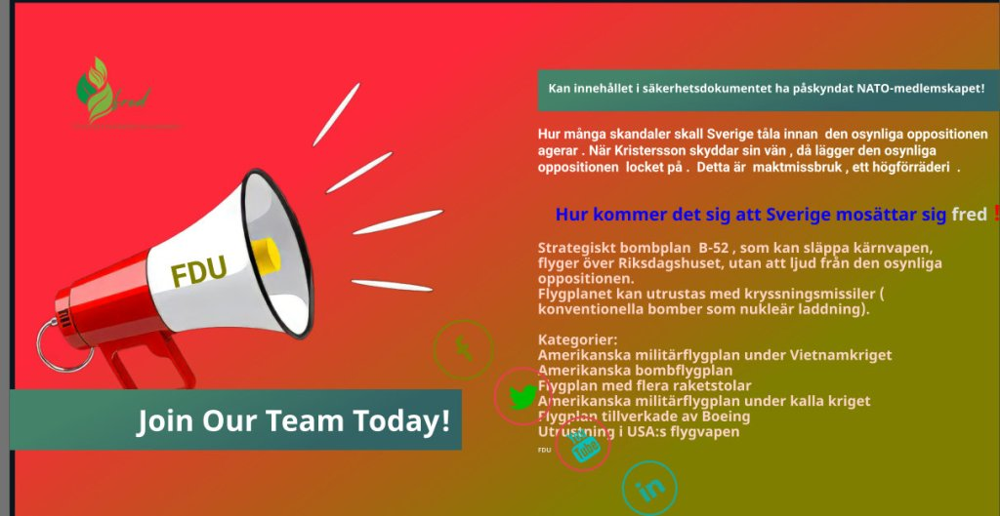
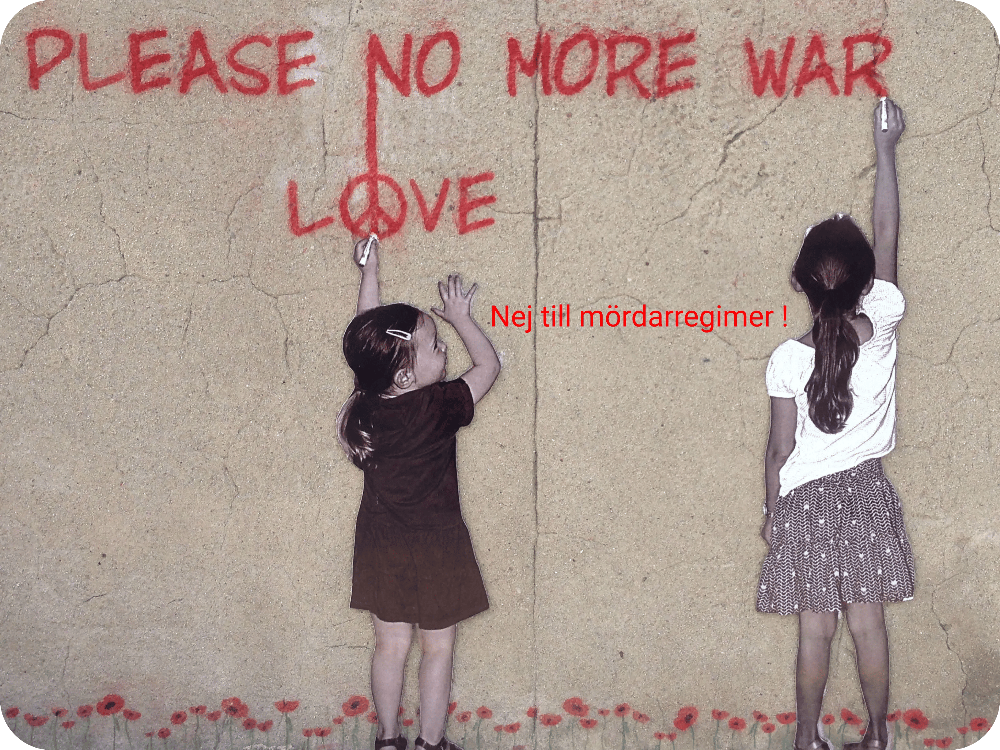

[Ett nej till kärnkraft beslutades redan 1980 av svenska folket vid en folkomröstning .!](https://multireligionvalsystem.eu.org/Nej-till-karnkraft/)

Om en lag endast kan upphävas genom en ny lag måste rimligtvis en demokratisk folkomrösting om kärnkraften som sådan också kunna upphävas genom en ny folkomröstning om huruvida Sverige skall bygga nya kärnkraftverk.Satsa i stället på en modern och ren teknik som t ex

solpanelsanläggningar m.m.

Det är också rimligt att upphäva ett odemokratiskt beslut om Sveriges anslutning till militäralliansen NATO utan en föregående folkomröstning genom ett demokratiskt beslut d v s en folkomröstning om Sverige skall lämna militäralliansen, NATO eller inte.

Är det inte militäralliansen NATO som har ockuperat Sverige och inte någon diktator ?

Försvarsmakten tog över Anngrets hem för militära aktiviteter att utföras av NATO som förstör vår miljö , luft och sprider rädsla för krig.

Vapenindustrin (försvarsindustrin) är en ohållbar och miljöförstörande industri och därför måste den avvecklas på samma sätt som tobaksindustrin !

**Krig utgör ett hot mot miljön och mänskligheten.**
