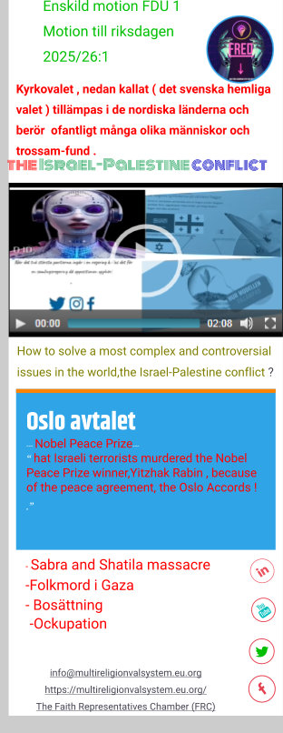

FDU utgår från religion för fred , i år är det ett politiskt-religiöst val i Sverige (kyrkoval) men det är inte många med invandrarbakgrund som känner till det valet trots att samtliga riksdagspartierna deltar i detta val ; för det är hemligt.

Partiledare vars parti deltar i kyrkovalet , talmannen som har rösträtt samtidit som han öppnar kyrkomötet som om Sverige skulle ha två parallella parlament , Trots detta vill varken kyrkan eller svensk media ta upp det .

Kyrkovalet har två positiva element

1. Infört demokrati i sina trossamfund (protestantiska kyrkan i de nordiska länderna ) genom kyrkoval.

3. Har givit de som fyllt 16 år rösträtt vilket betyder att de protestantiska eleverna och de som tillhör något ungdomsförbund, studieförbund eller kvinnoförbund som tillhör riksdagspartierna får praktisera demokrati två år innan det allmänna valet.

Kyrkovalet , nedan kallat ( det svenska hemliga valet ) tillämpas i de nordiska länderna och berör ofantligt många olika människor och trossamfund .

\- Kyrkovalet har trots sina positiva syften nackdelar som överväger fördelarna .

Det är inte lämpligt att begära att någon tillhörande ett annat trossamfund att konvertera till kristendomen och dessutom välja protestantiska trossamfund för att erhålla rösträtt . Ej heller uppmanas de elever som är 16 år att konvertera till kristendom och dessutom välja ett protestantiskt trossamfund.

\- Varken demokratiministern, kulturministern eller skolministern märker skilnaden mellan olika elevers rättigheter trots att de går i samma skola och dessutom läser samma ämne , religionskunskap,

\- Demokratin är mer utvecklad i det hemliga valet där alla från 16 års ålder har rösträtt vilket betyder att antalet röstberättigade och deltagande i det valet är mycket högre än vad som gäller i det allmänna valet och EU-valet.

- Inom EU är det bara de nordiska länderna som har kyrkoval . Även Norge som står utanför EU har kyrkoval. Andra medlemstater i EU saknar motsvarande val och motsätter sig att införa demokrati i sina trossamfund och dessutom berövar de sina ungdomar rätten att praktisera demokrati på samma sätt som i de nordiska länderna.

Det nuvarande hemliga valet, kyrkovalet saknar stöd bland andra trossamfund och svenska elever i svenska gymnasir i alla de nordiska länderna . Der är okänt inom EU och även bland många flyktingar och med inavandrarbakgrund i de nordiska länderna .

Med andra ord motarbetar de freden i Mellanöstern.

_Den 76 år gamla konflikten som ingen amerikansk presdient har lyckats med att lösa , inte någon av FN:s generasekreterar har heller lyckats med att hitta någon lösning på konflikten. Inte ens någon av påvarna har klarat av det uppdraget. Inte ens något av Nobels fredspris har hjälpt._

_That Israeli terrorists murdered the Nobel Peace Prize winner,Yitzhak Rabin , because of the peace agre[ement, the Oslo Accords !](https://community.multireligionvalsystem.eu.org/2025/03/enskild-motion-fdu-1-motion-till.html)_

2025/26:1
