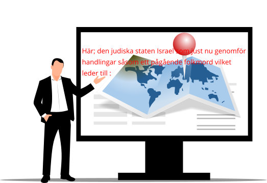
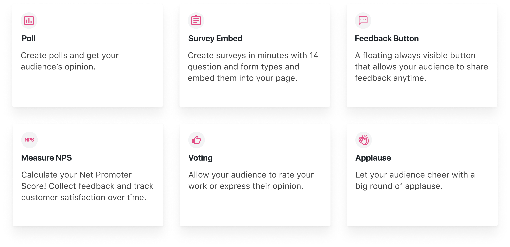
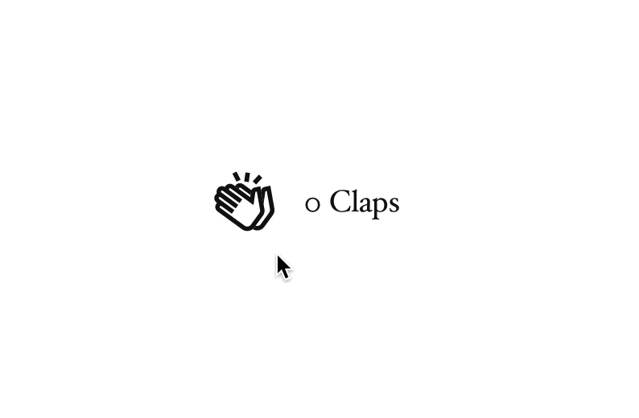
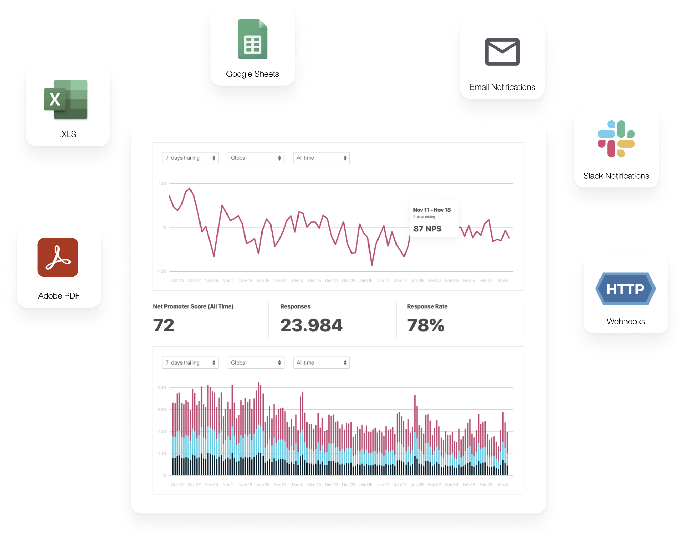

_Hur svenska kvinnor utvecklat demokrati under demokratiministrar som till 99% har varit kvinnor ?_

_Här jämför vi tre kvinnliga statsråd i SSD-regeringen , två statsråd som har en bakrund i den fanatiska kristna rörelsen Livits Ord, energiministern och finansministern som har rösträtt i det hemliga valet medan den odemokratiska demokratiministern tillhörande ett annat trossamfund än ett protestantiskt saknar rösträtt ._

_Är demokratin på tiillbakagång under nuvarande demokratiminister med bakgrund som flykting_ _**Parisa Molagholi**_ _medan demokratin förblev outvecklats under tidigare demokratiministrar Britta Lejon, Mona Sahlin , Jens Orback ,Nyamko Sabuni ,Birgitta Ohlsson, Alice Bah Kuhnke, och Amanda Lind .?_

_Notera här att alla ovan nämnda demokratiministar fått ärva demokratin men de är dåliga på att utveckla densamma !_

_Men den odemokratiska demokratiministern som förutom sig själv exkluderar EU-parlamentariker från att rösta i valet sep 2025 ,_ _Exkluderingspolitik_ _som skyddar d__e nordiska kyrkornas privilegier_ _!_

_Uteslutna jämte inkluderande ._

_Robert A. Dahl säger att vi måste hitta nya vägar att förmå politiska och byråkratiska eliter på både nationell och internationell nivå att bättre följa demokratiska normer . Det är ingen lätt uppgift , men få utmaningar kan vara viktigare för en demokratianhängare ._

_Den prisbelönade norsk amerikanske , Robert A. Dahl skrev om How Democratic Is the American Constitution och att inget i gängse mening demokratisk land varken Sverge , USA eller något annat land ens kommer i närheten av det demokratiska idealet_

Exkluderingspolitik kan vara medveten eller omedveten politik .

En omedveten exkluderingspolitik är att man exkluderar sig från sina egna rättigheter som de svenska EU-parlamentariker som är icke kristna protestanter då de saknar kunskap om att det är val i Sverige som skall äga rum i sep 2025 men de har inte rösträtt trots att deras parti deltar i det valet..

_Robert A. Dahl missar teorin om att religionsfriheten är grundbulten i demokratin och att är demokratin som har givit alla trossamfund religionsfrihet.Det är därför man måste införa demokrati i alla trossamfund utan undantag. Det är enligt oss en lätt uppgift att införa demokrati i alla trossamfund . Trossamfund har nämligen undantagits från detta krav trots att grundlagen poängterar att demoktratin måste genomsyra alla samhällets områden._

_Detta sker genom en kyrkovalsreform._

De nordiska kyrkornas privilegier skyddas genom exkluderingspolitik .

Om några månader , sep-2025 , är det val i Sverige men det är hemligt för att varken den odemokratiska demokratiministern , riksdagspartierna som deltar i valet eller massmedia vill tala öppet om det därför kallas det för det svenska hemliga valet.

_Har Europaparlamentet en demokratiminister som EU:s medborgare har röstat fram eller en krigsminister ?_

Vapenindustrin (försvarsindustrin) är en ohållbar och miljöförstörande industri och därför måste den avvecklas på samma sätt som tobaksindustrin !

**Krig utgör ett hot mot miljön och mänskligheten.**

[Preview this post](https://wordpress.org/support/article/how-to-use-the-preview-function/) if you would like to test the Crowdsignal blocks from your visitors perspective. _Oh and please feel free to delete this draft post anytime_, it was only created for demo purposes.

## Overview

Let's start with a quick overview of all our current blocks available in your WordPress editor. You can [find all these blocks inside your block library via searching](https://wordpress.com/support/wordpress-editor/) for their name or simply by searching "Crowdsignal".

If you want to learn more about Crowdsignal please go to [crowdsignal.com](https://crowdsignal.com) and join our little [community](https://crowdsignalfeedback.wordpress.com/) all about feedback here.

## Polls

We all have opinions! Curious about the opinion of your audience? Start asking with our poll block. It makes creating a poll as fast and simple as listing bullet points.

 You can choose between a button or a list style for your answer options, and you can fully customize the styling of the block.  By default the poll block will support your theme styling, but it’s up to you if you want to keep it. You can customize the style how you want, from font-family to border colours.

Just click in the poll below and start editing.

And everything else you expect from a Crowdsignal poll is also available — such as setting “single answer” or “multiple answer” choices, a customised confirmation message, poll timeframe, and avoidance of double voting.

Here is a short demo video for how to set up this block, not that you would need it ;)

## Feedback Button

You might have spotted it already, in the bottom left corner of this page: Our Feedback button.

This is a floating button that lives above your site's content. Always visible this button makes giving feedback easy! User can send you a message and provide their email address so you could can get back to them. Needless to say that you can fully customize the design and text, including the label of the button itself. Feel free to make it a "Contact me" or "Say hello" button or anything you like.

And yes, you can change its placement! You can put the button in any corner of your site. Just try it! Click in the feedback and start editing.

Don't miss out on your customers' feedback. Keep your door open anytime and place a feedback button on all your pages.

## Voting

Sometimes we need just quick and fast feedback from our audience. A quick voting button might be all you need. Fully customizable of course.

There is already a “like” button at the end of a WordPress post that you can click to express satisfaction or agreement. But what if you want to ask readers their opinion on a subject in the middle of a post? Or what if you want to present several ideas and find out which one is the most popular? Wouldn’t it be great to ask readers what they think without having to leave the editor or switch to another service or plugin?

That’s what we thought! Say hello to our Voting Block:

It’s a simple block that adds two voting buttons—thumbs up, thumbs down—to your post wherever you want to place them. Customize the block in different sizes and colors, with or without a border, and with or without a visible vote counter. Put several in a single post, next to different ideas, to see how they stack up for readers. Make the block your own!

## Applause

The Applause block is a simpler and more playful version of our Voting block. The main differences are users only being able to give positive feedback and encouraging users to “make as much noise as they want”. Meaning this block does not only allow repeated voting, but even encourages it.

Let your audience make some noise with a big round of applause.

[Preview this post](https://wordpress.org/support/article/how-to-use-the-preview-function/) and try clapping yourself! It's fun.

The block currently comes in three different sizes, and can be customised with a button-like styling, including a border, border radius and some colour customisation options.

## Embed Surveys & Forms

So far we only talked about quick and fast ways to collect feedback or opinions from your audience. But what if you have many questions or want to create simple forms? You can do this with Crowdsignal, too! Create a survey or form on app.crowdsignal.com and embed it into your WordPress post or site. Similar like here:

https://crowdsignal.survey.fm/product-market-fit-score

The Crowdsignal survey above was embedded using our "Single question per page mode." It’s exactly what it sounds like: In this mode, no matter how many questions your survey has, your respondents will always see one question at a time. Single Mode shines when you embed a survey into your website or blog post. Surveys with multiple questions can take up a lot of space, overwhelming your site. If you’re not sure whether your readers will take the survey at all, it disrupts the reading experience. With Single Mode, a survey  uses the same amount of space as an image, even a really long survey.

Once they provide an answer (or skip the question),  the next question loads. It has a playful  feel, like flipping through a slide show. Every answered question feels like progress.

You can choose between several transition options, and decide whether the questions should move from top to bottom, or from left to right.

**Ready to create one? Here’s how:**

\- Go to [app.crowdsignal.com](https://app.crowdsignal.com/dashboard) (we will log you in with your WordPress.com account - magic ;)) .

\- Create a new survey.

\- In the Editor, choose “Single Mode” at the top left.

\- Then create as many questions as you like and style your theme.

\- When you are ready click on Sharing and copy the URL of your survey.

\- Go back to your WordPress editor and paste the URL of your survey into your post

\- Done! Your survey will appear in your post.

Here is a short demo video for you that shows you how it works in less than a minute:

## Measure NPS

While we are driving our projects, working hard on our products, we all wonder: How are we doing? Are people satisfied with our service? Are we doing better since last month? 

Sometimes you want to measure your progress over time. [Measure and monitor the customer satisfaction and growth potential of your product with a Net Promoter Score](https://crowdsignal.com/2021/03/16/measure-nps/).

We have built a Gutenberg block for you that makes it easier than ever before to track your Net Promoter Score on WordPress. If you have [previewed this post](https://wordpress.org/support/article/how-to-use-the-preview-function/) before, you might have seen the NPS question already in a modal window.

The moment you add the block, you are basically done. The design of the block is based on your site’s theme. You can still customize the styling of the block, or edit the questions, but that might not even be necessary.

To get the most out of your NPS data, it is important to show the question only to users that are already familiar with your service or product. You can configure the block to only show to repeat visitors. It’s more likely you will get feedback from someone who knows what they are talking about, and you can make sure new users are not interrupted during their first visit to your site.

After you publish the block go to the results page of the block and monitor your results. We have built a special results page for you to track your NPS score and to analyse any additional feedback.

We provide an analytics dashboard with our block that automatically calculates the Net Promoter Score for you in real-time and allows you to monitor your score over time. Are the differences geographic? Filter your results based on countries.

By the way, did you know you also can get email notifications or a ping in your Slack channel any time you get an NPS rating? Just click on the little “connect” button on your results page.

Here is a quick tutorial video on how it works.
