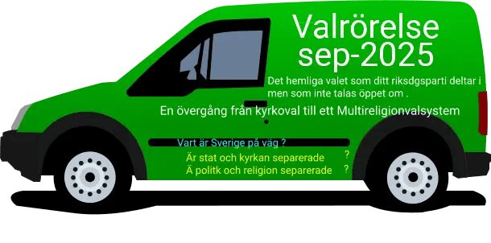

Följande extremt viktiga demokratiska råd till socialdemokraterna vid deras [Partikongress 2025](https://goteborg.socialdemokraterna.se/goteborg/nyheter/artiklar/2024-01-26-partikongressen-2025-till-goteborg) , Onsdag 28 maj.

[De fyra faktorerna är:](https://fdu.multireligionvalsystem.eu.org/tre-reformer-som-forandrar-varlden/)

1. Att lösa den 77 år gamla konflikten som tidigare socialdemokratiska politiker överlämnat till er genom ohållbar politik , ofullbordad separation mellan staten och kyrkan samt mellan religion och politik .

3. Jämställdhet inom partiet , se nedan

5. Demokratiskt deltagande och demokratisk utveckling inom riksdagspartierna.

7. Att lösa problemet d v s separationen mellan kyrka och stat och mellan religion och politik

Genom detta vill vi väcka medvetandet hos S:s partistyrelse och dess medlemmar tillhörande olika trossamfund. Detta har med den 77 år långa konflikten mellan Israel och Palestina att göra som tidigare S-generationer överlämnat till er genom ohållbar politik.

Vi har tidigare konstaterat att det 30-åriga kriget handlar om två trossamfund inom kristendomen vilket var lättare att lösa. Även kriget i Nordirland handlade om samma sak och var därför lättare att lösa. Däremot den 77 år långa konflikten mellan Israel och Palestina handlar om två olika religioner och därför är den svårare att lösa .

Mordet på Nobels fredspristagare som deltog i Oslo-avtalet utfördes av egna judiska religiösa extremister som satte stopp för freden i Mellanöstern. Därför är konflikten mellan Israel och Palestina en religiös konflikt och den kan endast lösas genom att demokrati införs i alla trossamfund utan undantag .

Mordet på FN:s förhandlare Folke Barnadotte som även han blev mördad av religiösa judar .

Målet är att vi och ni tillsammans genom en hållbar politik skall förhindra att den konflikten överlämnas till nästkommande politiska generationer.

**Frågan är hur kommer det sig att riksdagspartierna intresserar sig för kyrkovalet nu när de hävdar att kyrka och stat är separerade och likaså religon och politik ?**

Nu när allmänheten inklusive riksdagspartierna vet att den konflikten är en religiös konflikt vid sidan av ockupationer och bosättningar som nu har utvecklats till ett pågående folkmord , även om tvåstatslösningen lyckas , den religösa konflikten mellan två olika religioner kommer aldrig att lösas om vi inte inför demokrati i alla trossamfund utan undantag som i de nordiska länderna som har lyckats med detta genom kyrkovalet .

[Tvåstatslösningen](https://dpns.wordpress.com/hur-loser-man-den-77-ar-langa-konflikten-israel-palestina-en-steg-for-steg-guide/) måste därför kompletteras med ytterligare en avgörande åtgärd nämligen att införa demokrati i alla trossamfund utan undantag med början i de trossamfund som är icke protestantiska på samma sätt som de nordiska länderna som redan har infört demokrati genom kyrkovalet.

A**vvikelse hos riksdagspartierna !**

Kyrkovalet i de nordiska länderna det s k hemliga valet som b la S deltar i innebär att S intresserar sig för religion, kristendomen , ja _**endast**_ protestantiska trossamfund .Det är därför de exkluderar andra politiker tillhörande någon annat trossamfund och detta har pågått under flera politiska generationer . Detta i sin tur innebär att religionen påverkar S:s politik . Samma sak gällar de andra riksdagspartierna .

De socialdemokratiska protestantiska politikerna exkluderar även sina egna kristna katoliker och ortodoxa politiker från att delta i kyrkovalet . Det är många socialdemokrtiska politiker som tillhör andra trossamfund som exkluderas från den demokratiska valmöjligheten .

Likaså gäller det för ungdoms-och studieförbund där de protestantiska medlemmarna får praktisera demokrati två år innan det allmänna valet, när de fyllt 16 år , medan andra tillhörande något annat trossamfund och som även de är medlemmar hos socialdemokraterna saknar den valmöjligheten.

Avvikelsen är att riksdagspartierna där majoriteten är protestanter deltar i kyrkovalet samtidigt som dessa exkluderar andra medlemmar tillhörande andra trossamfund än ett protestantiskt från att delta i den demokratiska processen .

Ett riksdagsparti indelat i tre olika grupperingar den ena har extra rösträtt medan andra saknar en sådan . En grupp har två valmöjligheter, rösta eller avstå från att rösta medan andra grupper saknar motsvarande valmöjlighet. Ytterligare en ungdomsgrupp som får praktisea demokrati två år innan det allmänna valet är de protestanter som fylt 16 år medan andra exkluderas från den möjligheten.

Tänk på att det handlar om hela Norden och alla registrerade tossamfund och deras medlemmar, dessa är naturligtvis väldigt många . Varken demokratiministern, jämställdhetsministern , riksdagspartierna , kyrkorna , trossamfund i allmänhet eller de organisationer som håller på med demokrati är medvetna om det problemet .

Ytterligare ett problem är att häftig kritik mot en viss religion ofta hörs från olika håll som har med traditioner som olika religioner har fört med sig och en del går ännu hårdare genom att i handling bränna t ex en helig skrift . För att kunna ändra på detta måste det införas demokrati i alla trossamfund, utan undantag , genom att remformera kyrkovalet.

Ytterligare en avvikelse är att finansieringen av trossamfunden sker med skattemedel som de protestanstiska kyrkorna undantas från genom att dessa har egen budget måste också åtgärdas genom ytterligare en reform motsvarande partistödet.

Att lösa den långa konfliketn samtidigt som man separerar politik och religion och kyrkan från staten vilken kan uppnås genom en kyrkovalsreform vilket är målet .

Vapenindustrin (försvarsindustrin) är en ohållbar och miljöförstörande industri och därför måste den avvecklas på samma sätt som tobaksindustrin !

**Krig utgör ett hot mot miljön och mänskligheten.**
