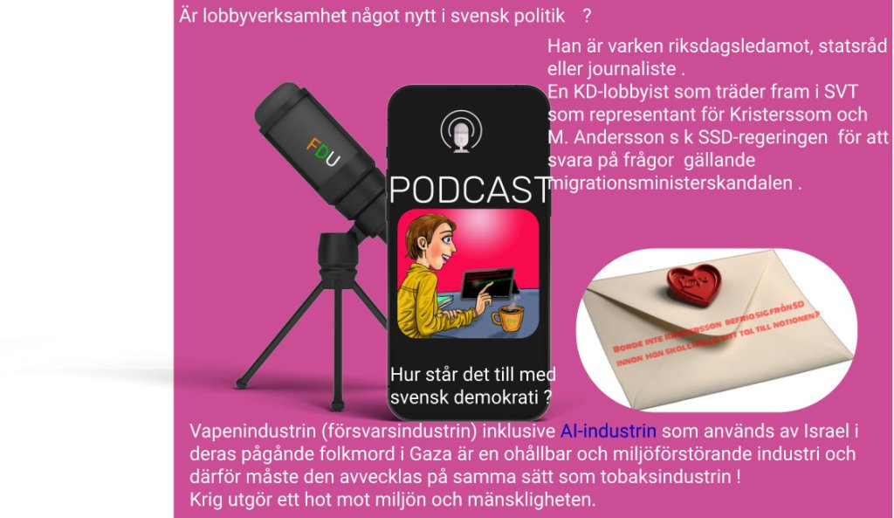

Menar den israeliske ambassadören vid SR:s intervju att det var judarna själva som deltog i förintelsen av de egna judarna under andra världskriget och att Israel utnyttjar det demokratiska stödet från västvärlden som NATO och EU ( Sverige, Danmark och Finland ) med att begå den värsta förintelsen av palestiner och att den demokrati som de tillämpar ger dem rätten till att begå miljöbrott och motarbeta klimatmålet och Internationella brottmålsdomstolen, ICC för att skydda krigsförbrytare som gömmer sig undan rättvisan.

Israeliske ambassadören skjuter över ansvaret till NATO och EU men om ett enda NATO-land , USA är ansvarigt för Israels handlingar är detta att betrakta som att samtliga NATO-länder bär ansvaret för detta på samma sätt som när NATO värvar nya medlemmar .

Menar den israeliske ambassadören att Putin äger rätt att försvara sig mot NATO:s utvigdning.

_Warszawapakten_ och NATO dödsförklarades av Gorbachev och därför belönades han med Nobels fredspris.

Menar den israeliske ambassadören att judiska terrorister hade rätt att mörda _Yitzhak Rabin_ , en jude, fredspristagare tillika premiärminister som deltog i Oslo-processen vilkens fred stoppades av dessa judar.

Menar den israeliske ambassadören att en tidigare ambassadör ägde rätt att vandalisera ett konstföremål vid en konstutställning i centrala Stockholm.

Är den israeliske ambassadören stolt över att hans land besitter två egenskaper, mordiska och vandalism som sträcker sig över hela Mellanöstern ?

Listan kan ta lika lång tid att läsa som Israel har existerat

Ordet är fritt !

Vapenindustrin (försvarsindustrin) inklusive [AI-industrin som Israel använder i sitt pågående folkmord](https://dpns.wordpress.com/political-campaign/) , är en ohållbar och miljöförstörande industri och därför måste den avvecklas på samma sätt som tobaksindustrin !

**Krig utgör ett hot mot miljön och mänskligheten.**
