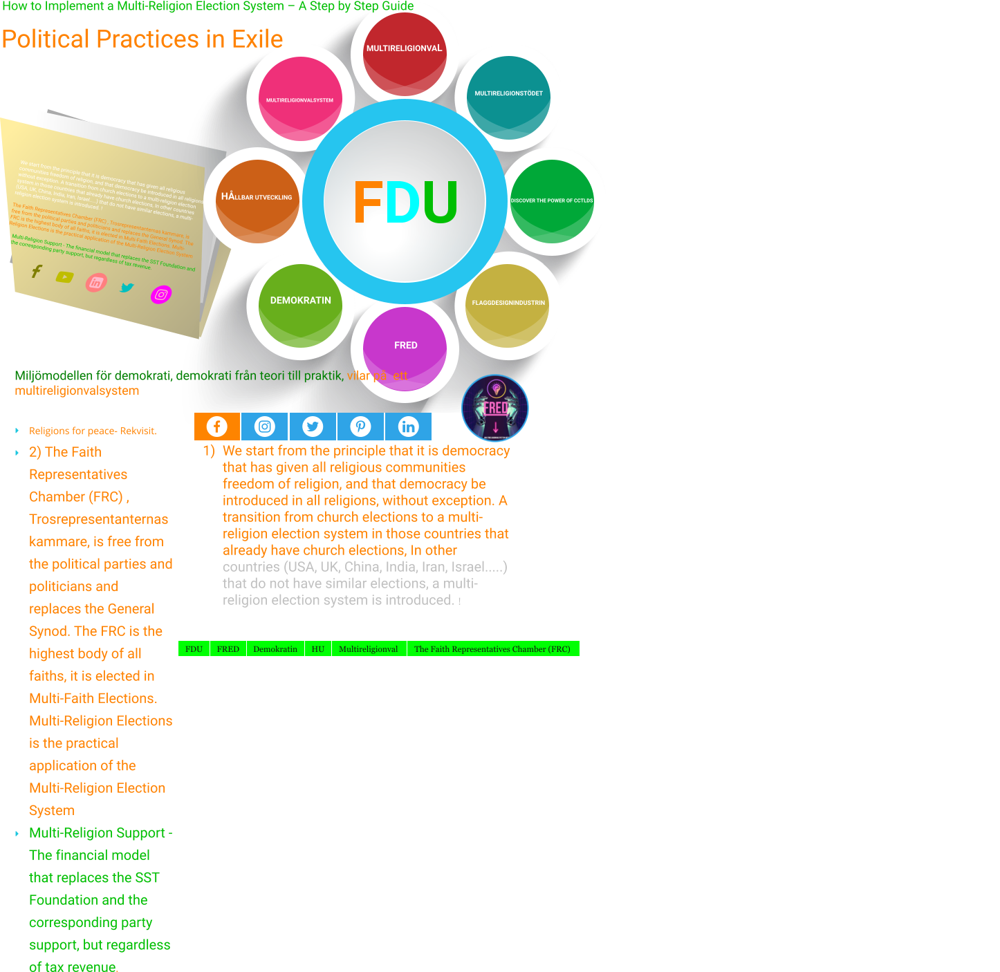

Genom kyrkovalsreformen (Religions for peace - Rekvisit ) i de nordiska länderna bidrar vi till [att teologin och religionsundervisningar blir intressantare](https://dpns.wordpress.com/hur-loser-man-den-77-ar-langa-konflikten-israel-palestina-en-steg-for-steg-guide/) , vi separerar religionen från staten och politik från religion blir verklighet.

Frågan är om denmed invandrarbakgrund om två månader behöver uppleva det ojämställda samhället i Sverige då riksdagspartierna som man röstar på eller är medlem i deltar i ett hemligt svenskt val, kyrkovalet , trots att kyrka och stat , politik och religion officiellt är separerade fast inte i praktiken.

Vi har redan ett ojämställt samhälle i de nordiska länderna genom att en del ungdomar som fyllt 16 år får extra förmån , privilegium , rösträtt vid den åldern , de får i praktiken praktisera demokrati två år innan det allmänna valet , EU-valet eller vid folkomröstning medan andra ungdomar med invandrarbakgrund exkluderas från denna rättighet och möjlighet . Ett ojämlikt samhälle trots att Sverige har en jämställdhetsminister , demokratiminister och skolminister . Ett ojämlikt samhälle och detta märks redan i gymnasieskolor där 16 -åringar tillhörande olika trossamfund går .

Det ojämlika samhället har fortsatt trots att de med invandrarbakgrund är med och är partikamrater i ungdomsförund, studentsförbund eller kvinnoförbund och att deras partier döljer det ojämlika samhället genom att exkludera dem från dessa valmöjlighter ?

Ett ojämlikt samhälle märks även på den geriatriska avdelningen , äldreboendet och anstalter där en del har två valmöjligheter , rösta eller avstå medan andra med invandrarbakgrund som sitter där inklusive andställda med invandrarbakgrund saknar dessa valmöjligheter , de får inte rösta och kan inte heller avstå.

Vi lyfter fram människors betydelse och behov i samhället även när de har begränsad rörelseförmåga och begränsad frihet på grund av olika skäl det kan handla om sjuka , handikappade , äldre eller de som avtjänar långa fängelsestraff genom att engagera sig i denna fråga .

Om invandrarföreningar , trossamfund , riksdagen, regeringen högskolor, företag ,industrin ,armen, de som bor i äldreboende och de som är inlåsta på olika anstalter få en gemensam aktivitet genom att vara med och reformera kyrkovalet så att alla från 16-års ålder får rösträtt oavsett religion genom en övergång från kyrkovalet till ett Multireligionvalsystem med undantag för riksdagspartierna som inte får delta kan vi separera stat och religion, religion och politik samtidigt som vi får ett jämställt samhälle i hela Norden och så småningom inom EU och övriga länder.

På skolor, arbetsplatser , daghem , äldreboenden , fängelser , armen , skjukhus, umgås folk med olika religioner och trossamfund . En del ateister och en del troende . Inom den troende delen i motsats till den sekulariserade ett fåtal som nyttjar sin rösträtt i de allmänna valen. För att kunna locka dessa till vallokalerna i de allmänna valen, EU-valet eller folkomröstning måste (Religions for peace -rekvisitar ) nedan uppfyllas :

1) We start from the principle that it is democracy that has given all religious communities freedom of religion, and that democracy be introduced in all religions, without exception. A transition from church elections to a multi-religion election system in those countries that already have church elections, In other countries (USA, UK, China, India, Iran, Israel.....) that do not have similar elections, a multi-religion election system is introduced. !

2. The Faith Representatives Chamber (FRC) , Trosrepresentanternas kammare, is free from the political parties and politicians and replaces the General Synod. The FRC is the highest body of all faiths, it is elected in Multi-Faith Elections. Multi-Religion Elections is the practical application of the Multi-Religion Election System 3) Multi-Religion Support - The financial model that replaces the SST Foundation and the corresponding party support, but regardless of tax revenue.

Detta är den enda konfliktlösningsmodell som kan lösa den 77-år långa konflikten mellan Israel och Palestina så att den konflikten inte överlämnas till nästkommande generation och samtidigt skyddar vi miljön i Mellanöstern .

The arms industry (defense industry) including the AI industry used by Israel in their ongoing genocide in Gaza is an unsustainable and environmentally destructive industry and therefore must be dismantled in the same way as the tobacco industry!

War poses a threat to the environment and humanity.
