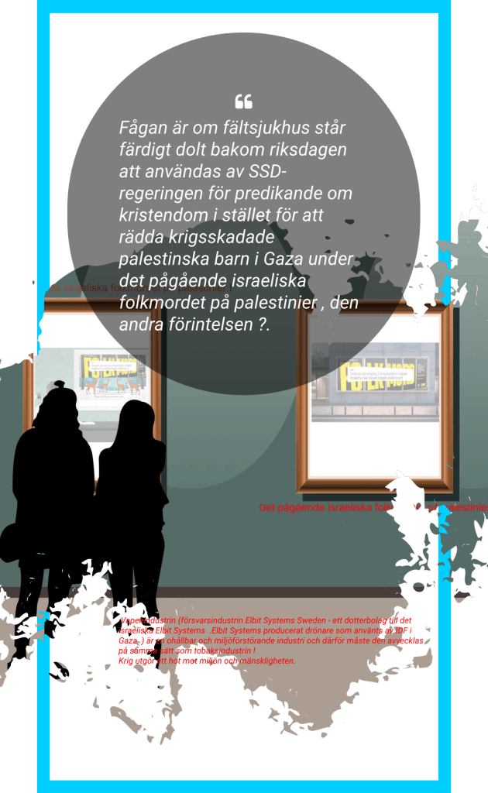

Hur länge kan SSD-regeringen som deltar i det svenska hemliga valet som äger rum nu i sep 2025 hålla ut mot svenska folkets protester ?

Den anarki , kaos och de skandaler som råder i landet kan bero på att Sverige styrs av militären som i sin tur styrs av militäralliansen NATO vilken i sin tur dirigeras av Trump . Det är därför Sverige saknar en fungerande regering medan oppositionen är död . Sverige och Israel saknar en fungerande opposition vilket krävs av en demokrati , till och med en stark opposition. Med demokratin som täckmantel legitimeras ett pågående folkmord (förintelse), försvar av ockupationen , bosättningar, krig, svält och miljöförstörelse och dessutom kvävs yttrandefriheten ,journalister förbjuds att verka samt som Internationella brottsmålsdomstolen motarbetas. Ett typiskt diktatoriskt styre .Det är att konstatera [att den 77 år långa konflikten mellan Israel och Palestina](https://rfp.multireligionvalsystem.eu.org/separerar-politik-fr%C3%A5n-religion.html) har överlämnats från den ena generationens politiker till den andra .

Fågan är om fältsjukhus står färdigt dolt bakom riksdagen att användas av SSD-regeringen för p**redikande om** kristendom i stället för att rädda krigsskadade palestinska barn i Gaza under det pågående israeliska folkmordet på palestinier , den andra förintelsen ?

SSD-regeringen motsätter sig även att ta emot krigsskadade palestinska barn . SSD-regeringen respekterar inte heller Barnkonventionen .

[I kris bildas nämligen en samlingsregering !](https://multireligionvalsystem.eu.org/a-parallel-parliament/)

Fältsjukvård per definition är hälso- och sjukvård i krigszoner i den situation då den kvalificerade hjälpen och definitiva vården inte kan nås inom den så kallade Gyllene timmen. Sverige hade 35 stora fältsjukhus samt 15 marina fältsjukhus men två kompletta sjukhus skänktes till Estland och Litauen .Andra fältsjukhus har hamnat i olika delar av världen via hjälporganisationer.Under pandemin sattes fältsjukhus upp i bland annat Älvsjö och Göteborg för att hantera det ökade trycket på vården.

Vapenindustrin (försvarsindustrin Elbit Systems Sweden - ett dotterbolag till det israeliska Elbit Systems .Elbit Systems producerat drönare som använts av IDF i Gaza ) är en ohållbar och miljöförstörande industri och därför måste den avvecklas på samma sätt som tobaksindustrin !
Demokratiska partiet, De Nya Svenskarna (DPNS)
**Krig utgör ett hot mot miljön och mänskligheten.**
