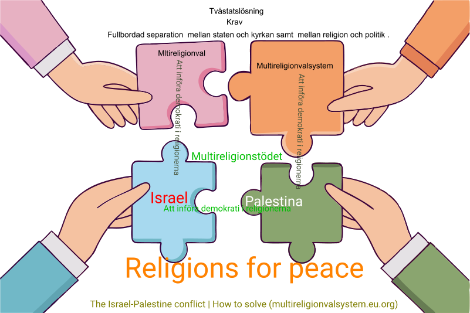

Ofullbordad separation mellan staten och kyrkan samt mellan religion och politik

Varför tillåts vissa partier som har sina rötter i nazismen, facismen och sionismen inom EU att utnyttja EU-medborgarnas röster i syfte att försöka återuppliva nazismen, facismen och sionismen dessa tre döda ideologier ?

Vilken är anledningen till att EU fortsätter att tillåta de religiösa kristna partierna att delta i EU-valet trots att EU-staterna skall vara skilda från religionen och politiken skall vara skild från religionen ?

Ofullbordad separation mellan staten och kyrkan samt mellan religion och politik .

<figure>



<figcaption>

Ofullbordad separation mellan staten och kyrkan samt mellan religion och politik .

</figcaption>

</figure>

De religiösa kristna partierna i de nordiska länderna har egna val, kyrkoval, vilket exkluderar andra trossamfund från att delta. Den kristna-judiska politiska alliansen (inklusive det judiska centralrådet) utgör ett hinder så att den 77 år långa Israel-Palestina konflikten inte kan lösas och den kristna-judiska politiska alliansen vill överlämnas konflikten till nästkommande generation.

```
Why did the Israeli terrorists assassinate Nobel Peace Prize winner Yitzhak Rabin when he participated in the peace agreement, the Oslo Accords! . Is that assassination different from non-peace prize winners like the assassination of Kennedy and Palme?
```

I år sep-2025 är det ett politiskt-religiöst val i Sverige men det är inte många med invandrarbakgrund som känner till det valet trots att alla riksdagspartierna inklusive KD deltar i detta val ; för det är hemligt. Varken demokratiministern, jämställdhetsministern , riksdagspartierna , kyrkorna , trossamfund i allmänhet ,organisationer eller svensk media vill ta upp det . Why the flags of the nations wave with religious symbols over the EU, UN and NATO therefore it is important to replace the religious symbols with the countries' own ccTLDs ?

Hur kommer det sig att EU tillåter den israeliska försvarsadvokaten och Trump att utöva utpressning , hot och trakasserier mot personal vid den Internationella brottmålsdomstolen, ICC ?

När Israel ansökte hos Internationella brottmålsdomstolen, ICC om att skjuta upp arresteringsordern mot Netanyahu och hans generaler avvisades detta av tribunalen vilket har gjort att Trump åker runt i världen inte för att skapa fred utan för att söka en utväg för att rädda Netanyahu så att han kan fortsätta med utrensningspolitiken samtidigt som Trump själv rentvår sig från inblandning i förintelsen av palestinier i Gaza.

Nato-landet USA:s agerande (stödet till Israel) måste betraktas som att samtliga Nato länder agerar även de med att stödja Israel om inte flera andra Nato-länder inom EU sätter stopp för detta handlande .

Vapenindustrin (försvarsindustrin Elbit Systems Sweden - ett dotterbolag till det israeliska Elbit Systems .Elbit Systems producerat drönare som använts av IDF i Gaza ) är en ohållbar och miljöförstörande industri och därför måste den avvecklas på samma sätt som tobaksindustrin !

**Krig utgör ett hot mot miljön och mänskligheten.**
