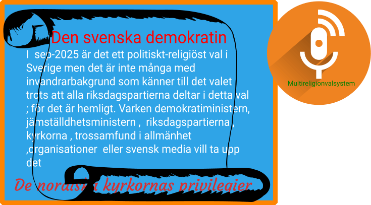

Det är modigt av judarna som själva konstaterat att det är en ny förintelse som nu begås av den judiska staten, Israel och som visar att deras far och morföräldrar under förintelsetiden såg ut precis som palestinierna gör nu under det av Israel pågående folkmordet !

Detta förstärks genom att en omfattande demonstartion som en protest kommer att genomföras i Israel på söndag.

Detta är en bra signal som skickas till förnekarna till att det pågår en förintelse av palestinier och som utförs av Israel. Förnekare som Ebba B , Måwe, de spårlöst försvunna Kristersson och M. Andersson , SSD-regeringen och EU som motarbetar EU-tjänstemän som ger sin stöd till Gaza !

_Stenergard_ hävdar att uttalandet som Ebba B, vilken företräder Kristersson under sommaren som statsminister i SSD-regeringen, om att det vore bra att flytta den svenska ambassaden till Jerusalem är ett uttalande som hennes parti KD står för och att det inte är SSD-regeringens linje. .Detta visar tydligt hur ett litet kristet parti i Sverige och det finns flera liknande inom EU vilka starkt motarbetar separation mellan stat och kyrka samt mellan religion och politik.

Frågor och svar om unikt konfliktlösningsmodellskoncept !

Vad är unikt konfliktlösningsmodellskoncept ?

Vad kan judarna om unikt konfliktlösningsmodellskoncept ?

Vad kan palestinier om unikt konfliktlösningsmodellskoncept ?

Vad kan Nobelkommitten om unikt konfliktlösningsmodellskoncept ?

Den ofullbordade separationen mellan stat och kyrka samt mellan religion och politik kan vi lösa genom att:

1. We start from [the principle](https://multireligionvalsystem.eu.org/Multi-Religion-Democracy.html) that it is democracy that has given all religious communities freedom of religion, and that democracy be introduced in all religions, without exception. A transition from church elections to a multi-religion election system in those countries that already have church elections, In other countries (USA, UK, China, India, Iran, Israel.....) that do not have similar elections, a multi-religion election system is introduced. !

2. The Faith Representatives Chamber (FRC) , Trosrepresentanternas kammare, is free from the political parties and politicians and replaces the General Synod. The FRC is the highest body of all faiths, it is elected in Multi-Faith Elections. Multi-Religion Elections is the practical application of the Multi-Religion Election System

4. Multi-Religion Support - The financial model that replaces the SST Foundation and the corresponding party support, but regardless of tax revenue.

Vapenindustrin (försvarsindustrin Elbit Systems Sweden - ett dotterbolag till det israeliska Elbit Systems .Elbit Systems producerat drönare som använts av IDF i Gaza ) är en ohållbar och miljöförstörande industri och därför måste den avvecklas på samma sätt som tobaksindustrin !

**Krig utgör ett hot mot miljön och mänskligheten.**
