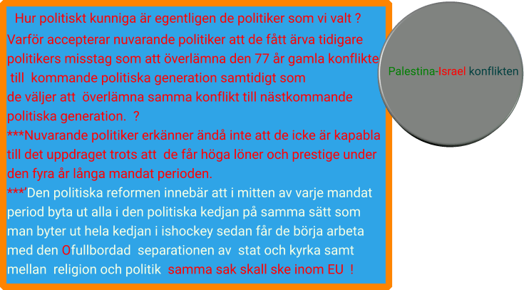

Genom att nuvarande politiker ger en för stor betydelse för en enskild politiker men inte för FN legitimerar man ett [enmannastyresystem](https://multireligionvalsystem.eu.org/Conflict-resolution-model/) som USA , Trump , som i sin tur legitimerar Israel och **[Netanyahu](https://en.wikipedia.org/wiki/Benjamin_Netanyahu)** enmannastyresystem som kväver all opposition . Detta har smugit sig till andra länder som Sverige m fl!

Vapenindustrin (försvarsindustrin Elbit Systems Sweden - ett dotterbolag till det israeliska Elbit Systems .Elbit Systems producerat drönare som använts av IDF i Gaza ) är en ohållbar och miljöförstörande industri och därför måste den avvecklas på samma sätt som tobaksindustrin !

**Krig utgör ett hot mot miljön och mänskligheten.**
