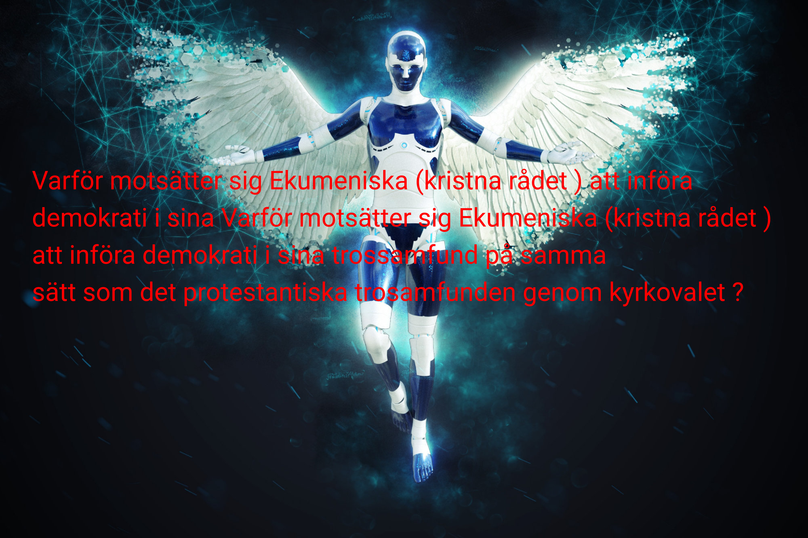

Mot Ekumeniska (Sveriges kristna rådets ) argument !

Hur kommer det sig att de starkaste rösterna inom kristendom och judendom i Sverige protesterade mot kyrkorna klockringning for fred under det pågående israeliska folkmordet i Gaza ?

Hur kommer det sig då att rn av de starkaste rösterna inom kristendomen , Ebba B som är vice SSD-regeringens chef uttalat sig positivt om förintelsen av palestinier genom att hävda att Israel gör världen en tjänst och att SSD-regeringen ska flytta den svenska ambassaden till Jerusalem .

Två möjliga skäl till det kristna rådets Ekumeniska vecka är :

1. Det svenska hemliga valet där b la KD , Ebba B deltar som äger rum i sep 2025 , kyrkovalet. Detta visar den ofullbordade seprationen mellan stat och kyrka och religion och politik .

Detta visar också att många kristna , katoliker och ortodoxa i Sverige exkluderas från att deltar i det svenska hemliga valet.

2. Hade Ekumeniska (kristna rådet ) inte ha fyllt 100 år kanske inte en sådan vecka i Stockholm ägt rum .Varför väntade Ekumeniska (kristna rådet ) så länge trots att det israeliska folkmordrt i Gaza har pågott mycket länge .

Det står nämligen så här: att Under Ekumeniska veckan högtidlighåller kristna hundraårsminnet av det stora ekumeniska Stockholmsmötet från 1925 och dess fokus på fred och gemenskap.

Samtidigt som de starka rösterna inom kristendom och judendom i Sverige protesterade mot kyrkornas klockringning for fred .

Varför motsätter sig Ekumeniska (kristna rådet ) att införa demokrati i sina trossamfund på samma sätt som det protestantiska trosamfunden genom kyrkovalet ?

Kristna i Sverige är indelade i två gruperingar , den ena har demokraiserat sitt trossamfund medan den andra motsätter sig dettal !

Vapenindustrin (försvarsindustrin Elbit Systems Sweden - ett dotterbolag till det israeliska Elbit Systems .Elbit Systems producerat drönare som använts av IDF i Gaza ) är en ohållbar och miljöförstörande industri och därför måste den avvecklas på samma sätt som tobaksindustrin !

**Krig utgör ett hot mot miljön och mänskligheten.**
