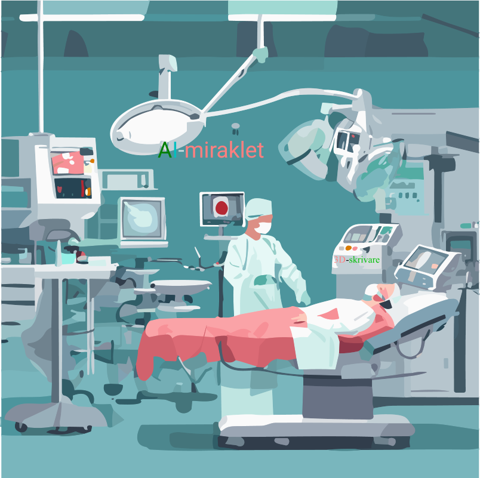

Förtydligande om Multireligionval (A multi-religion election) som Google AI Overview refereras till ..

Förtydligande om Multireligionval (A multi-religion election) som Google AI Overview refereras till ..

```
A multi-religion election är den praktiska delen om hur valet i praktiken tillämpas .Multi-religion elections are the practical application within the Multi-religion election system. Folk oavsett bakgrund deltar i Multireligionvalet från 16 års ålder , syftet är att få kunna praktisera demokrati två år innan det allmänna valet eller EU-valet på samma sätt som i kyrkovalet. A multi-religion election som i motsats till kyrkovalet inga politiska partier får delta i . Endast ledare för olika trossamfund väljes i A multi-religion election. A multi-religion election system (Multireligionvalsystem) innebär en reform av kyrkovalet som endast tillämpas i de nordiska länderna .
```

```
A multi-religion election system (Multireligionvalsystem) kommer att tillämpas i hela världen som i EU, USA , Austalien, Indien, Kina, Saudiarabien medan man i de nordiska länderna som redan har kyrkoval  övergår från kyrkoval till ett A multi-religion election system (Multireligionvalsystem). Kyrkovalet innebär att man har infört demokrati i sina trossamfund , protestantiska i de nordiska länderna. Påven (katoliker och ortodoxa saknar motsvarande val vilket motarbetar valet av en kvinnlig påve eller någon annan kvinnlig ledare.
Syftet med reformen är att införa demokrati i alla trossamfund, utan undantag, för att kunna lösa den 77 år långa konflikten mellan Israel och Palestina som varken USA:s  president, FN:s generalsekreterare, påve , kung , premiärminister , krig eller Nobels fredspris har lyckats med att lösa.  De har övelämnat samma konflikt till kommande generationer .
```

- I 30 åriga kriget mellan protestanter och katoliker dödades en svensk kung men efter 30 år lyckades man lösa den konflikten för att där handlade det om samma religion, kristendomen. Samma sak när det gällde kriget mellan protestanter och katoliker i Nordirland som man lyckade med att lösa, även där efter 30 år, för att det handlade om samma religion, kristendomen.

- Den 77 år långa konflikten mellan Israel och Palestina handlar om olika religioner , judendom och islam som går tillbaka till de 8 korstågen.

```
Mordet på Nobels freds- pristagare som deltog i Oslo-avtalet utfördes av egna judiska terrorister som satte stopp för freden . Därför är konflikten mellan Israel och Palestina en religiös konflikt och den kan endast lösas genom att demokrati införs i alla trossamfund utan undantag .   
```

- De religiösa partierna i tvåpartisystem som finns i USA, Frankrike, Storbritannien , Israel m fl samt att religion och politik inte är separerade från varandra och att stat och religion icke heller är separerade bl a på grund av att de religiösa partierna fått blanda sig i politiken och delta i det allmänna valet och EU-valet som stiftar lagar i en lagstiftande församling, som riksdag, parlament, kongress m fl.

- De religiösa partierna får välja mellan att antingen upplösas eller villkorligen reformera sina stadgar där religionen inte nämns eller används i den allmänna debatten eller politiken, diskussionen m.m. I de här fallen får de religiösa partierna efter upplösning i stället kandidera en katolik, ortodox eller protestant till ledare. Inget politiskt parti, religiöst eller icke religiöst får delta i Multireligionvalet, A multi-religion election.

Varför är valet sep 2025 så hermligt ?

I år sep-2025 är det ett politiskt-religiöst val i Sverige men det är inte många med invandrarbakgrund som känner till det valet trots att alla riksdagspartierna deltar i detta val ; för det är hemligt. Varken demokratiministern, jämställdhetsministern , riksdagspartierna , kyrkorna , trossamfund i allmänhet ,organisationer eller svensk media vill ta upp det .



```
Det är därför nedanstående rekvister som gäller .
```

We start from the principle that it is democracy that has given all religious communities freedom of religion, and that democracy be introduced in all religions, without exception. A transition from church elections to a multi-religion election system in those countries that already have church elections, In other countries (USA, UK, China, India, Iran, Israel.....) that do not have similar elections, a multi-religion election system is introduced. !

The Faith Representatives Chamber (FRC) , Trosrepresentanternas kammare, is free from the political parties and politicians and replaces the General Synod. The FRC is the highest body of all faiths, it is elected in Multi-Faith Elections. Multi-Religion Elections is the practical application of the Multi-Religion Election System  
Multi-Religion Support - The financial model that replaces the SST Foundation and the corresponding party support, but regardless of tax revenue.

```
Den unika konfliktlösningsmodellen tillämpas så att  den 77 år långa konflikten mellan Israel och Palestina kan lösas utan dröjsmål och förhindra att den överlämnas till nästkommande generation, med en hållbar politik.

Att förhindra framtida religiösa konflikter eller religiös inblandning i politiken samt avsaknande av religionsfrihet i  religiöst eller diktatoriskt styrda länder genom att  klargöra separationen mellan religion och politik och stat och religion. Religion skall stå för för fred och demokrati och att det är detta som har givit alla trossamfund religionsfrihet betonas såväl i skolundervisningen, allmän politisk debatt och massmedia.

- Tänk på att alla trossamfund kan använda sina lokaler som vallokaler på samma sätt som svenska kyrkan.
- Tänk på att genom kyrkovalreformen uppmuntrar och lockar vi flera religiösa som inte röstar i allmänna val att rösta även i detta.
```

Why the flags of the nations wave with religious symbols over the EU, UN and NATO therefore it is important to replace the religious symbols with the countries' own ccTLDs ?

En ny falggdesgin .

Varför saknar de fattiga länderna en fungerade toppdomän ?

En aktivering av de fattiga ländernas ccTLDs

Allt detta ovan nämnda kallar vi för tre reformer som förändrar världen. Multireligionvalsystem, De fattiga ländernas ccTLDs och en ny flaggdesign .

Vapenindustrin (försvarsindustrin Elbit Systems Sweden - ett dotterbolag till det israeliska Elbit Systems .Elbit Systems producerat drönare som använts av IDF i Gaza ) är en ohållbar och miljöförstörande industri och därför måste den avvecklas på samma sätt som tobaksindustrin !
