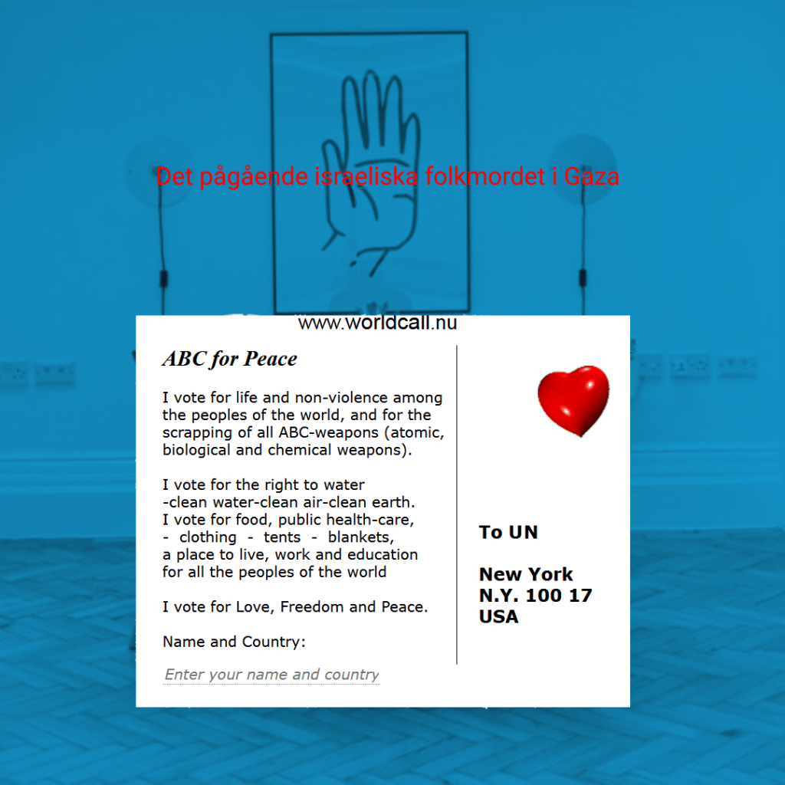

- 
    

- Frågan är om svenska åklagare och polismyndigheter har kännedom om den israeliska kampanj och propagande som riktas till judarna i Europa ?

- 1) Att mobilisera så många som möjligt av de judar som har dubbla medborgarskap i Europa till kriget i Gaza och Libanon mot Hizbollah i samband med avväpningskampanjen .

- 2) En kampanj för judar och de som sympatiserar med Israel, inklusive Israels vänner, att anmäla andra för hets mot folkgrupp , s k antisemitism.

- Syftet kan vara att belasta det europeiska rättsystemet så att fokus flyttas från folkmord och krigförbrytare , miljöbrott m .m till fördel för Israel.

- 3) Finanskampanj riktas till judarna att de skall finansiera Israels krigföring

- Vapenindustrin (försvarsindustrin Elbit Systems Sweden - ett dotterbolag till det israeliska Elbit Systems .Elbit Systems producerat drönare som använts av IDF i Gaza ) är en ohållbar och miljöförstörande industri och därför måste den avvecklas på samma sätt som tobaksindustrin !

FDU

Fred

Demokrati

Hållbar utveckling

Multireligionval
