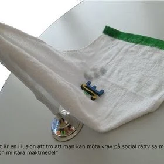

[Startsida](http://community.multireligionvalsystem.eu.org/)

# Agenda tog SVT upp det norska valet men inte det svenska hemliga valet som delar svenska folket mellan invandrare som saknar rösträtt och infödda svenska som har rösträtt. Båda valen äger rum samtidigt nämligen sep 2025 . Nedan följer är de viktigaste [reformerna](https://community.multireligionvalsystem.eu.org/2025/09/Varför%20%20är%20det%20omöjligt%20%20för%20de%20nordiska%20länderna%20att%20välja%20en%20statsminister%20med%20invandrarbakgrund) för norrmännen , det är nödvändigt att börja med dessa under valrörelsen sep-2025 det svenska hemliga valet sep 2025!. Detta gäller nämligen alla de nordiska länderna. Steg för steg. Liberalernas partiordförande i Sverige och ett statsråd från Liberalerna saknar rösträtt i det valet som Liberalerna deltar i. Ett statsråd kulturministern, Moderaterna, saknar rösrrätt medan Moderaterna som parti deltar i det hemliga valet. Det här bara i Sverige men det ser likadant ut i de övriga nordiska ländernaa . 1) Reformera kyrkovalet , [De nordiska kyrkornas privilegier](https://community.multireligionvalsystem.eu.org/2025/09/Varför%20%20är%20det%20omöjligt%20%20för%20de%20nordiska%20länderna%20att%20välja%20en%20statsminister%20med%20invandrarbakgrund). I sep-2025 är det ett politiskt-religiöst val i Sverige men det är inte många med invandrarbakgrund som känner till det valet trots att alla riksdagspartierna deltar i detta val ; för det är hemligt. Varken demokratiministern, jämställdhetsministern , riksdagspartierna , kyrkorna , trossamfund i allmänhet ,organisationer eller svensk media vill ta upp det . Att lösa den 77 år gamla konflikten som tidigare politiker överlämnat till er genom ohållbar politik samt ofullbordad separation mellan staten och kyrkan samt mellan religion och politik . Israel utnyttjar den ofullbordade separationen mellan stat och kyrka samt mellan religion och politik.Det är detta som kallas för den kristna-judiska politiska alliansen. Frågan är : Why did the Israeli terrorists assassinate Nobel Peace Prize winner Yitzhak Rabin when he participated in the peace agreement, the Oslo Accords! . Is that assassination different from non-peace prize winners like the assassination of Kennedy and Palme? Ofullbordad separation mellan stat och kyrka samt mellan religion och politik utnyttjas av främlingsfientliga krafter både nationellt och inom EU-parlamentet. . En fullbordad separation mellan stat och kyrka samt mellan religion och politik sker genom kyrkovalsreformen .Enligt följande princip. We start from the principle that it is democracy that has given [all religious communities](https://multireligionvalsystem.eu.org) freedom of religion, and that democracy be introduced in all religions, without exception. A transition from church elections to a multi-religion election system in those countries that already have church elections, In other countries (USA, UK, China, India, Iran, Israel.....) that do not have similar elections, a multi-religion election system is introduced. ! The Faith Representatives Chamber (FRC) , Trosrepresentanternas kammare, is free from the political parties and politicians and replaces the General Synod. The FRC is the highest body of all faiths, it is elected in Multi-Faith Elections. Multi-Religion Elections is the practical application of the Multi-Religion Election System Multi-Religion Support - The financial model that replaces the SST Foundation and the corresponding party support, but regardless of tax revenue. Vi följer Bruntland- deklarationen och arbetar tillsammans för att den 77 år gamla konflikten inte skall överlämnas till nästa generation , vi skyddar människor och miljön samtidigt samtidigt som vi skyddar demokratin, demokratin utvecklas. Samtidigt uppmuntrar vi de kreativa unga som exempelvis miljöaktivisten Greta Thunberg så att fler unga vågar att t ex avveckla miljöförstörande industri som olje och vapeindustrin m m. 2) Att norska folket valde militäralliansen NATO men valde att stå utanför EU som det norska folket har mycket mer gemensamt med än med militäralliansen NATO samtidigt som Norge delar ut Nobels fredspris. 3) I kris bildas nämligen en samlingsregering. Den svaga demokratin har lett till att många partier bildats under demokratins täckmantel men deras agerande visar på motsatsen. Detta i sin tur har lett till att i t ex Sverige valde Moderaterna och Liberalerna att bilda parregering med SD och KD. Det ena främlingsfientligt och som har sina rötter i nazismen och det andra är religiöst vars partiordförande har sina rötter i Livets Ord. Detta har i sin tur lett tll att Sverige övergivit neutraliteten och alliansfriheten tll förmån för militäralliansen NATO, kvävt oppositionen och har svårt att enas om utrikespolitiken. Här i Sverige används termen SSD-regering då S Magdalen Andersson överlämnat makten till SD efter bara 7 månader som första kvinnliga svenska statsminister. Hon har inte tagit initiativ till bildande av en samlingsregering under den kris som hon och Kristersson brukar använda som orsak till Sveriges medlemskap i militäralliansen NATO och som drog med sig ytterligare ett nordiskt land nämligen Finland. \*\*\*\* Magdalen Andersson ha aldrig varit SSU-ordförande och därför skulle hon aldrig ha blivit vald till S:s partiledare och senare till statsminister som hon misslyckades med att vara . S har inte separerat de två viktigaste posterna inom partiet, partiledarposten och statsministeposten på samma sätt som efter Brantings död . Den som var SSU:s ordförande före det Magdalen Andersson blev vald till statsminister hade invandrarbakgrund och hade större rätt till den posten . Två huvudorsaker kan vara möjliga i kombination. Dels att personen kanske saknar rösträtt i det svenska hemliga valet. Om han fått rösträtt i kyrkovalet, blivit konverterad till kristendom och sedan valt protestantism före katolisism eller ortodox då skickar han fel signal om att han av invandrarbakgrund måste bli konverterad för att kunna få rösträtt och bli politiskt jämställd. Dels för att kunna genomföra Sveriges medlemskap i militäralliansen NATO. Varför är det omöjligt för de nordiska länderna att välja en statsminister med invandrarbakgrund..kan det bero på de nordiska ländernas hemliga val, kyrkovalet som de kristna protestantiska politikerna deltar i ? Kristersson går ännu längre genom att underteckna DCA-avtalet, och ännu längre genom att blanda sig i domstolens arbete genom att få en person som blivit dömd i svensk domstol men som under överklagandeprocessen blev frisläppt i utbytesaffär , en kränkning av demokratin av maktdelingsprincipen. Han kan nämligen också göra som i Landerholmsaffären och fria honom från all anklagelse då oppositionen saknas. Dessa har gjort EU till ett högkvarter för militäralliansen NATO, då majortieten av EU- staterna är medlemmar i Nato. 4) Glöm inte massmordet i Utöja i Norge under Stoltenbergs regering. 5) Glöm inte Lasermannens jakt på invandrare i Sverige under Carl Bildts regering, m m 4) Fattiga ländernas och industriländernas toppdomän

Discover the power of cctTLDs. Why do the flags of nations wave with religious symbols over the EU, UN, and NATO? It's important to replace these symbols with the countries' own ccTLDs. This change would make the flags more meaningful and respectful. Vapenindustrin (försvarsindustrin Elbit Systems Sweden - ett dotterbolag till det israeliska Elbit Systems .Elbit Systems producerat drönare som använts av IDF i Gaza ) samt oljeindustrin är en ohållbar och miljöförstörande industri och därför måste den avvecklas på samma sätt som tobaksindustrin ! Krig utgör ett hot mot miljön och mänskligheten.
