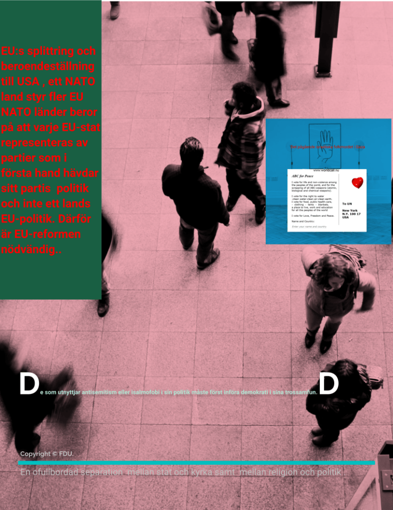

Är du filosof, professor,statsvetare, jurist, journalist eller politiker , här är en viktig och grundläggande analys av varför ni fått ärva den 77 år långa konflikten som ingen påve , amerikansk president , FN:s generalsekreterare , krig, vapenvila , förhandlingar har lyckats med att lösa utan den har överlämnats till flera generationers politiker som utan framgång har försökt att lösa konflikten, en ohållbar politik .

EU:s splittring och beroendeställning till USA , ett NATO land styr fler EU NATO länder

beror på att varje EU-stat representeras av partier som i första hand hävdar sitt partis politik och inte ett lands EU-politik. Därför är EU-reformen nödvändig.
