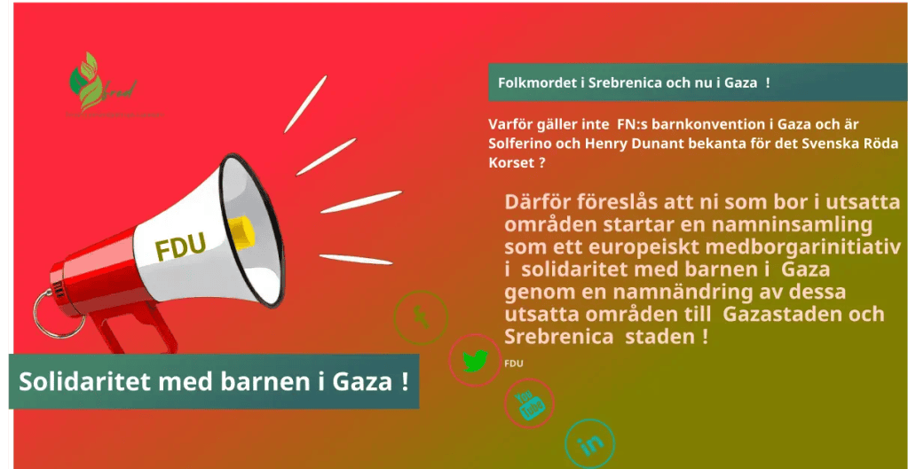

  
Varför gäller inte FN:s barnkonvention i Gaza och är Solferino och Henry Dunant bekanta för det Svenska Röda Korset ?

  
Vapenindustrin (försvarsindustrin Elbit Systems Sweden - ett dotterbolag till det israeliska Elbit Systems .Elbit Systems producerar drönare som används av IDF i Gaza  
) samt oljeindustrin som också är en ohållbar och miljöförstörande industri och därför måste den avvecklas på samma sätt som tobaksindustrin !
