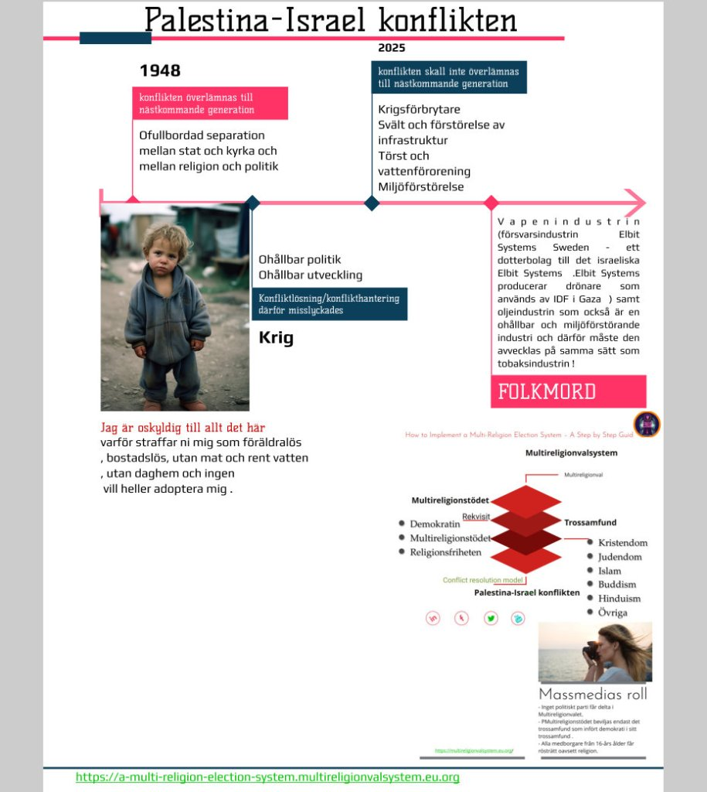

Hur kommer det sig då att IDEA som har sitt säte i centrala Stockholm inte är intresserat av en demokrati som kyrkovalet vilket äger rum söndagen den 21 sep 2025 där en f d statsminister, partiledare och de andra riksdagspartierna deltar .

Enligt de , International IDEA is an intergovernmental organization (IGO) with a mandate to support sustainable democracy worldwide.

Kan det bero på att katoliker och ordoxa samt judar, muslimer , buddister och hinduer som bor i [Sverige saknar rösträtt](https://multireligionvalsystem.eu.org/kyrkovalsreformen/) och därför inte själva har kännedeom om kyrkovalet och att även IDEA saknar kunskap om detta val?

International IDEAs enda uppgift är att förespråka en hållbar demokrati i hela världen och därför finansieras denna enorma organisation med skattemedel.

Varför ligger International IDEA Headquarters vid Strömsborgsbron 1,SE-103 34 Stockholm

Sweden i stället i för i något av de utsatta områden där flyktingar och svenskar med invandrarbakgrund bor som t ex vid SIDA?
