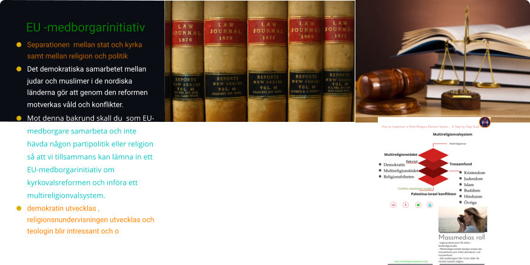

Tillsammans skall vi, oavsett bakgrund , utveckla EU genom att gemensamt komma med reformer i form av EU -medborgarinitiativ !

Vår EU-reform innebär att du som har din hemvist i Sverige och röst i EU-valet oavsett din bakgrund iranier, ryss, amerikan, palestinier, indier, afrikan, latinamerikan, kines , italienare, britt , muslim, jude, buddist, kristen, hindu skall betraktas som EU-medborgare och att alla ni tillsammans skall utveckla EU genom att gemensamt komma med reformer i form av EU -medborgarinitiativ .

Går du i skolan och möter någon med en sådan bakgrund som nämns ovan var öppen och våga fråga om denna elev har något förslag på vad som kan förbättras när det gäller EU- medborgare .

På arbetsplatsen gör arbetsgivaren likadant,

Träffar du någon bekant eller sitter på tåget på en långresa gör likadant.

I din kommun, i fastigheten där du bor, fråga dina grannar och på detta sätt kan samarbete ske och kontakten med folket bli bättre .

Likaså för samtliga trossamfund i Sverige.

Nedan visar ett [EU- medborgarinitiativ som kan lösa](https://multireligionvalsystem.eu.org/How-to-Implement-a-Multi-Religion-Electoral-System-A-Step-by-Step-Guide/) den 77 år långa konflikten mellan [Israel och Palestina](https://multireligionvalsystem.eu.org/Conflict-resolution-model/) så att vi kan förhindra att den konflikten överlämnas till nästkommande generation.

Att ta itu med frågan om varför separationen mellan stat och kyrka samt mellan religion och politik inte har kunnat genomföras sedan år 2000 ?.!

Vi vet redan att riksdagspartiernas deltagande i kyrkovalet är huvudorsaken och utgör ett problem och ett hinder mot ett fullbordande av separationen mellan stat och kyrka samt mellan religion och politik.

Separationen mellan svenska kyrkan och staten ägde i teorin rum år 2000 men trots det deltar riksdagspartierna och andra politiker , s k kyrkopolitiker i kyrkovalet.

Nu några dagar efter kyrkovalet, 21 sep-2025 som f d moderatledaren tillika statsminister deltog i och då Socialdemokraterna fick majoritet konsterar vi att det finns större resurser i form av förmögenhet som svenska kyrkan förfogar över och som politikerna är intresserade av . Arvode eller extraknäck ?

Att genomföra en fullbordad separation mellan stat och kyrka samt mellan religion och politik möter därför ett tyst motstånd från samtliga riksdagspartier.

Den ofullbordade separationen mellan stat och kyrka samt mellan religion och politik har

konstaterats dels genom att en f d moderatledare tillika statsminister deltog i det hemliga svenska valet, kyrkovalet som ägde rum söndagen den 21 sep-2025 , dels att de andra riksdagspartierna också deltog i kyrkovalet där Socialdemokratiska arbetarpartiet fick majoritet. Trots detta det är inte många med invandrarbakgrund som känner till det valet.

Därför var valet söndagen den 21 sep-2025 ett politiskt-religiöst val i Sverige men det är inte många med invandrarbakgrund som känner till det valet trots att alla riksdagspartier deltar i detta val ; för det är hemligt. Varken demokratiministern, jämställdhetsministern , riksdagspartierna , kyrkorna , trossamfund i allmänhet ,organisationer som ägnar sig åt demokrati eller svensk media vill ta upp det .

Kyrkovalet den 21 sep 2025 och judarna i Sverige ?

Anta att det judiska trossamfundet i Sverige vill införa demokrati i sitt trossamfund

i likhet med det protestantiska trossamfundet , svenska kyrkan, så att de judiska politikerna i de olika riksdagspartierna och judiska ungdomar som fyllt 16 år får rösträtt i nästa val om fyra år sep 2029 .

Men om vi tillsammans, oavsett bakgrund, lämnar in EU-medborgarinitativ om att reformera kyrkovalet till ett Multireligionvalsystem går det naturligtvist mycket snabbare .

Om [Multireligionvalsystem läs vidare,](https://a-multi-religion-election-system.multireligionvalsystem.eu.org/) om [Multireligionval läs vidare](https://a-multi-religion-election.multireligionvalsystem.eu.org/) om [Multireligionstödet läs vidare.](https://multi-religion-support.multireligionvalsystem.eu.org/)

Varför Multireligionvalsystem ?

Att varje trossamfund har ett eget valsystem som kyrkoval, är mer komplicerat, dyrt och opraktiskt därför behövs en kyrkovalsreform , dvs en övergång från kyrkovalet i de nordiska länderna till ett Multireligionvalsystem. I andra länder som saknar kyrkoval skall man direkt tillämpa ett Multireligionvalsystem. Detta innebär att demokrati införs i alla trossamfund, utan undantag, som i de nordiska länderna och demokratisera religionerna i övriga länder som Iran, Israel, USA, Kina, Indien Frankrike, Italien, Storbritannien o s v.

- Blir det möjligt för en judisk kvinna att väljas till rabbin som respekteras av andra judar på samma sätt som svenska kyrkan genom kyrkovalet kan välja en kvinna till ärkebiskop ? Judarna i Sverige och övriga nordiska länder måste lära sig den modellen ?.

- Blir det möjligt för andra kristna, katoliker och orodoxa att välja en kvinnlig religiös ledare?

- Ungdomar som har fyllt 16 år skall bli jämställda när det gäller att praktisera demokrati två år innan det allmänna valet.

- Genom att demokratisera religionerna kan den 77 år långa konflikten lösas mycket snabbt och enkelt så att inga flera dödas och att även ockupation och olagliga bosättningar upphör .

- Det demokratiska samarbetet mellan judar och muslimer i de nordiska länderna gör att genom den reformen motverkas våld och konflikter.

Förvirring kring termerna judar, israeler och sionister utgör ett stort problem som skapar konflikter och antisemitism. Vilka har rösträtt i det israeliska valet ? En israelisk jude i Sverige med dubbelt medborgarskap har naturligtvis rösträtt i det israeliska valet.

En arab, muslim , som har sin hemvist i Sverige kan inte rösta i alla muslimska länder utan bara det land som personen har dubblet medborgarskap i .

Mot denna bakrund skall du som EU-medborgare samarbeta och inte hävda någon partipolitik eller religion så att vi tillsammans kan lämna in ett EU-medborgarinitiativ om kyrkovalsreformen och införa ett multireligionvalsystem.

Kom ihåg att demokratin utvecklas , religionsnundervisningen utvecklas och teologin blir intressant och omfattande samt att fred uppnås.

Vapenindustrin (försvarsindustrin Elbit Systems Sweden - ett dotterbolag till det israeliska Elbit Systems .Elbit Systems producerar drönare som används av IDF i Gaza ) samt oljeindustrin som också är en ohållbar och miljöförstörande industri och därför måste den avvecklas på samma sätt som tobaksindustrin !
