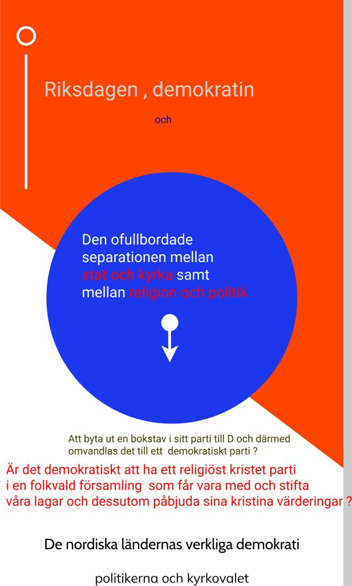

Partiledardebatten visade att 7 partiledare tog avstånd från SD och J. Åkessons parti t o m hans närmsta ideologier , KD och M. Det tyder på att Tidö håller på att gå i graven.

Talmännens roll i kris och hur svensk demokrati skall återställas efter Tidö!

Att byta ut samtliga partiledare med dess partistyrelse kan vara första steget innan valet 2025. !

Två områden måste talmännen ta upp i riksdagen för att undvika rn regeringskris:  
1) Undvika hämnddemokrati d v s onödiga misstroendeyrkanden och i stället följa den principen att i ktris bildas en samlingsregering så att överenskommelser inte får ersätta valet såsom D-Ö, J-Ö och Tidö. .  
2) Reformera kyrkovalet så att en fullbordad separation mellan stat och kyrka samt mellan religion och politik kan genomföras.  
Den ofullbordade separationen mellan stat och kyrka samt mellan religion och politik.

Opinionsundersökningar visar att nästa val 2026 kommer att leda till en regeringskris, svårigheter att bilda regering även om L inte få något mandat.

7 partier, S, V, MP, C, M,, SD,KD  
Enligt uteslutningsmetoden i det scenariet som ovan visar att M,SD och KD inte kan bilda regering.  
M,SD och KD kan inte heller bilda en samlingsregering då de själva har orsakat många problem och skandler. M,SD och KD själva har skapat den allvarliga kris som Sverige har hamnat i .  
Nu utgår vi från att L genm stödröstning blir kvar i riksgaen L , M,SD och KD kan inte heller bilda regering då L motsätter sig en sådan regering som SD får vara med.

Vad händer då om M, L och KD lockar C till samrbeta men utan SD .  
Svaret är att de fyra partierna (M, L , KD , C )inte har tillräckligt med stöd för att kunna bilda regering . Även om de har det stödet så kommer SD att ansluta sig till oppositionen och på det sättet fälla den.

Talmannens huvudvärk kanske kan lindras genom att oppositionen S, V, MP, C räddar L och på det sättet kan det bildas en majoritetsregering .  
Även här uppstår ett problem , varken C eller L vill ha med V i regeringssamarbet..

V kan nämligen fälla den regeringen genom att ansluta sig till M, KD och SD ,. V lyckades tidigare mot Stefan Löven (S) .

Det enda som de svenska väljarna vet är att valet av en ny talman efter valet 2026 blir en socialdemokrat och två andra talmän från andra partier.

Slutsatsen och rekommedationen  
Är att de nuvarande talmännen träffas i ett enskilt samtal om att lämna rådet till riksdagspartierna att bilda en samlingsregering .

MP, V och C kan nämligen bilda en samlingsregering utan S då S själv kvävde oppositionen som de själva ledde. Oppositionen är redan död .Oppositionen har redan kvävts. S anslöt sig till militäralliansen NATO utan föregående folkomröstning.  
S:s ledning sa nej til NATO och sedan Ja till NATO betyder att förtroendet till S har skadats och därför kan man inte lita på S kan styra landet .

S:s ledning kan bytas ut innan valet vilket kanske kan rädda S:s ansikte.  
S har nämligen alltid motsatt sig regeringsamarbete med V.

Den ofullbordade separationen mellan stat och kyrka samt mellan religion och politik och att det finns ett religiöst kristet parti i riksdagen utgör hindar för en demokratisk utveckling och politisk stabilitet.

[Partiledardebatten , Burkadebatt eller tröstdebatten ,](https://dpns.wordpress.com/political-campaign/) att inte ens svenska vapen som används vid folkmordet i Gaza nämndes och inte heller nämdes Sveriges anslutning till militäralliansen NATO utan en föregående folkomröstning .Det är oemokratiskt och detta är en fråga för programledarna.

Vapenindustrin (försvarsindustrin Elbit Systems Sweden - ett dotterbolag till det israeliska Elbit Systems .Elbit Systems producerar drönare som används av IDF i Gaza ) samt oljeindustrin som också är en ohållbar och miljöförstörande industri och därför måste den avvecklas på samma sätt som tobaksindustrin !
