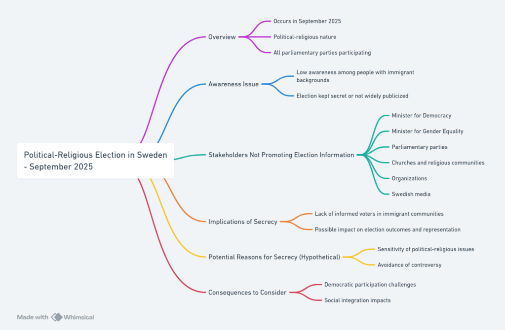

Multireligionvalsystemet har tre huvuduppgifter att lösa nämligen:  
1) Den ofullbordade separationen mellan stat och kyrka samt mellan religion och politik.  
2) Införa demokati i alla religioner utan undantag som börjar med de nordiska länderna som redan har infört demokrati i sina trossamfund genom kyrkovalet.  
I de nordiska länderna bor judar, katoliker, ortodoxa, muslimer m fl som inte har infört demokrati i sina trossamfund.  
3) Att lösa den 77 år långa konflikten mellan Israel och Palestina .

Att angripa problem 1 och 2 .  
Söndagen den 21 sep-2025 var ett politiskt-religiöst val i Sverige men det är inte många med invandrarbakgrund som känner till det valet trots att alla riksdagspartier deltar i detta val ; för det är hemligt. Varken demokratiministern, jämställdhetsministern , riksdagspartierna , kyrkorna , trossamfund i allmänhet ,organisationer som ägnar sig åt demokrati eller svensk media vill ta upp det .

Genom att riksdagspartierna och politiker, bl a en f d statsminister och partiledare, deltog i och nominerades i kyrkovalet i Sverige utgör ett hinder för att fullborda separationen mellan stat och kyrka samt mellan religion och politik.  
EU-valet påverkas . Även inom katolska och ortodoxa medlemsländer i EU saknas motsvarande val som kyrkovalet . EU är indelat i länder som har infört demokrati i sina trossamfund som de protestantiska i Sverige, Danmark och Finland medan andra motsätter sig detta och t o m saknar kunskap om kyrkovalet.  
De religiösa partierna och högerextrema blir fler och får finansieringsstöd , bildar politiska allianser som påverkar politiken såsom inom EU , USA m f l .

Problem 3: 3 How to solve a most complex and controversial issues in the world,the Israel-Palestine conflict ?  
Why did the Israeli terrorists assassinate Nobel Peace Prize winner Yitzhak Rabin when he participated in the peace agreement, the Oslo Accords! . Is that assassination different from non-peace prize winners like the assassination of Kennedy and Palme ?  
Eftersom mordet på Nobel Peace Prize winner Yitzhak Rabin som är jude, och Nobels fredspristagare, genomfördes av extrema judiska terrorister kan konstateras att den 77 år långa konflikten är en religiös konflikt vid sidan av ockupation, bosättare och som utvecklats till folkmord på palestinier i Gaza.  
Risken är att nästa fredsförhandlare också blir undanröjd av extremister och därför vill ingen riskera sitt liv . Konfliketen överlämnas till nästkommande generation med fortsatt dödande och fortsatt demolering av infrastruktur med mycket avancerade vapen som levereras från vapentillverkande länder , samt förstörelse av miljö , vatten och luft i Mellanöstern.  
Detta problem angrips genom följande reform.  
We start from the principle that it is democracy that has given all religious communities freedom of religion, and that democracy be introduced in all religions, without exception. A transition from church elections to a multi-religion election system in those countries that already have church elections, In other countries (USA, UK, China, India, Iran, Israel…..) that do not have similar elections, a multi-religion election system is introduced. !  
The Faith Representatives Chamber (FRC) , Trosrepresentanternas kammare, is free from the political parties and politicians and replaces the General Synod. The FRC is the highest body of all faiths, it is elected in Multi-Faith Elections. Multi-Religion Elections is the practical application of the Multi-Religion Election System  
Multi-Religion Support - The financial model that replaces the SST Foundation and the corresponding party support, but regardless of tax revenue.  
Vapenindustrin (försvarsindustrin Elbit Systems Sweden - ett dotterbolag till det israeliska Elbit Systems .Elbit Systems producerar drönare som används av IDF i Gaza ) samt oljeindustrin som också är en ohållbar och miljöförstörande industri och därför måste den avvecklas på samma sätt som tobaksindustrin !

[Besök israel](https://https://fdu.multireligionvalsystem.eu.org/israels-apartheid/)

[Besök MultiReligion-Election](https://frc-.multireligionvalsystem.eu.org/MultiReligion-Election-Education.html)  
[Besök Empowering Exiled Political Practices](<https://political-practices-in-exile.multireligionvalsystem.eu.org/Empowering-Exiled-Political-Practices.html >)  
[Besök MultiReligionValSystem](//a-multi-religion-election-system.multireligionvalsystem.eu.org/Implementera-ett-Multi-Religi%C3%B6st-Valssystem.html)

In my work, I explore[  
a multi-religion election system](https://multireligionvalsystem.eu.org/) as a conflict-resolution model in multireligious societies.
