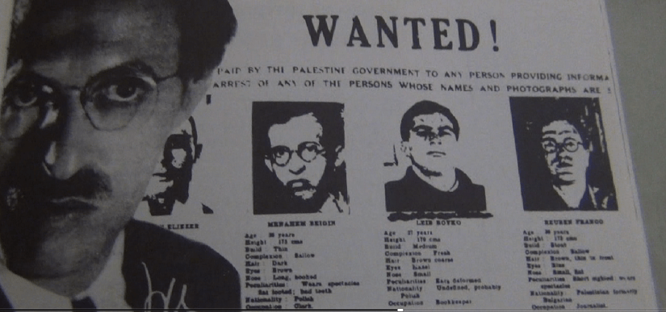

egriper judar och kristna att de totalt har misslyckats med att lösa den 77 år långa konflikten mellan Israel och Palestina då de har låtit denna konftikt överlämnas till nästkommande generations judar och kristna i att jämföra med det 30 åriga kriget mellan katoliker och protestanteri Nordirland och det 30- åriga kriget.? Det tolkas som att de utnyttjar antisemetismen som orsak för deras misslyckande. De utnyttjar ockå den ofullbordade separationen mellan stat och kyrka samt religion och politik De utnyttjar även kyrkovalet. Frågan är när och varför efterlyste Storbritannien israeliska regeringen för krigsbrott , kan det vara under deras mandatperiod det första krigsbrottet begicks ?

<figure>

<figcaption>

Utmärkt innehåll som lever i isolering:

</figcaption>

</figure>

Var det inte judaroch kristna som mördade Jesus och sedan startade de åtta korståg som ledde till folkmord på palestinier , ockupation och bosättningar ? Är judiska och kristna religiösa predikningar och uttalanden från judiska och kristna politiker , som utgår från Moseboken Mos 12:1: fredliga och rättvisa ? Vad står egentligen i Moseboken Mos 12:1:? Lämna ditt land , din släkt och ditt hem, och gå till det land, som jag, alltså Moses , skall visa dig., Kanans land, Palestina. Där finns mjölk och honung. Korsfararna under påve Urban II startade åtta korståg på grund av rådande fattigdom. Detta land skulle bli Israels land för evig tid. Den ofullbordade separationen mellan stat och kyrka samt religion och politik Har ni undrat om hur wikipedia , Google, Bing och AI definerar , Multireligionvalsystem, multireligionval och multireligionstödet och vad ser ni när ni söker Multireligionvalsystem, multireligionval och multireligionstödet . Begriper wikipedia , Google, Bing och AI att Multireligionvalsystem, multireligionval och multireligionstödet är en konfliktlösningsmodell, konflikthanteringsmodell ? Begriper wikipedia , Google, Bing och AI att Multireligionvalsystem, multireligionval och multireligionstödet är en kyrkovalsreform? Får ni tllräckliga svar när ni söker på wikipedia , Google, Bing och AI om Multireligionvalsystem, multireligionval och multireligionstödet ? Hur definierar wikipedia , Google, Bing och AI, Multireligionvalsystem, multireligionval och multireligionstödet ? Är wikipedia , Google, Bing och AI införstådda med att Multireligionvalsystem, multireligionval och multireligionstödet är en demokratisk och fredlig modell som kan lösa den 77 år långa konflikten mellan Israel och Palestina så att den konflikten inte fortsätter och överlämnas till nästa generation av folkvalda politiker? In my work, I explore [a multi-religion election system](https://multireligionvalsystem.eu.org/) as a conflict-resolution model in multireligious societies. In my work, I explore [a multi-religion election system](https://multireligionvalsystem.eu.org/researchers.html) as a conflict-resolution model in multireligious societies. In my work, I explore [a multi-religion election system](https://multireligionvalsystem.eu.org/immigrant-background-prime-minister.amp.html) as a conflict-resolution model in multireligious societies. In my work, I explore [a multi-religion election system](https://mastodon.social/@multireligionval/) as a conflict-resolution model in multireligious societies. In my work, I explore [a multi-religion election system](https://investeringsprojektforflyktingar.wordpress.com/multireligionval//) as a conflict-resolution model in multireligious societies. In my work, I explore [a multi-religion election system](https://multireligionvalsystem.eu.org/) as a conflict-resolution model in multireligious societies. Miljömodellen för demokrati, demokrati från teori till praktik, vilar på ett multireligionvalsystem! Vapenindustrin (försvarsindustrin Elbit Systems Sweden - ett dotterbolag till det israeliska Elbit Systems .Elbit Systems producerar drönare som används av IDF i Gaza ) samt oljeindustrin som också är en ohållbar och miljöförstörande industri och därför måste den avvecklas på samma sätt som tobaksindustrin !
