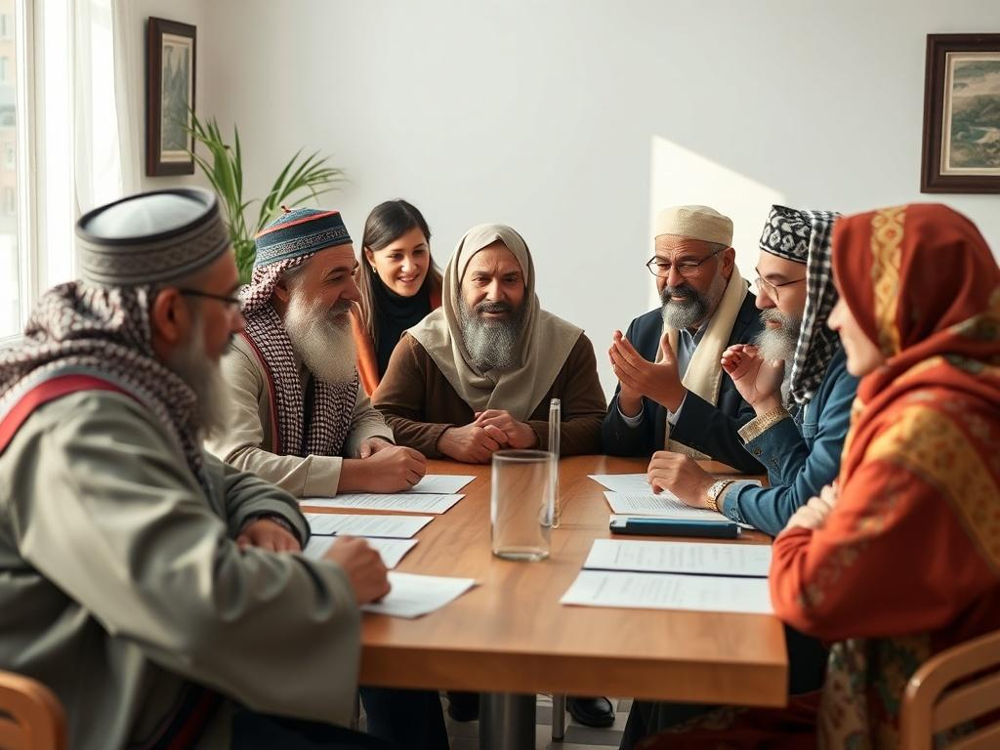

För de som hävdar att Maduro saknar legitimitet , vad händer om Putin attackerar EU och griper Von derr Leyien och hennes man eller _Zelenskyj_ och hans fru eller Kristersson och hans fru och [Alexander Stubb](https://www.google.com/search?client=firefox-b-d&hs=AkQU&sca_esv=82729a62d7e47fe1&q=Alexander+Stubb&si=AMgyJEveiRpRWbYSNPkEPxCUbItHSvun4xkRgDDPLmrOjDx35A--SJNRtGXKOYx2NJiIwK_UVvSSLEu7Un7stlAEp2a50uqAS58QKhl9yQcwnI_51Mh4_jnzpSuFeDMy-JMJXejzQY4ue6YJdr2GbyDvVIcoNUWfKfaoaPciQTdC3KON6QEY7Yx8023nFZDJ3vE77usXyhfa&sa=X&ved=2ahUKEwjgiLngyu-RAxVoJRAIHZIFFMkQmxN6BAgZEAI) och hans fru och för att föra dessa till Ryssland . Vad händer om arbaiska styrkor attackerar Israel och för bort Netanyahu och hans fru till Iran ?

Vad händer om Latinamerikanska styrkor attackerar USA och för bort Trump och hans fru till Kuba .

Är det inte så att det är Norge som har eldat på när de gav Nobels fredspris till fel person genom påverkan av militäralliansen NATO och att Natolandet Norge som delar ut Nobels fredspris i strid med Nobel testemente.

Är det en sådan värld som ni vill skall inleda 2026 , herr kyrkopolitiker som kommenterar internationell politik?

Den ofullbordade separationen mellan stat och kyrka samt mellan religion och politik kväver den politiska oppositionen samtidigt som den förenar nazismen, fascismen och sionismen.!



[Candidates from different religions must adhere to the following rules:](https://online-voting-system.base44.app/)

```
1) The incomplete separation between state and church and religion and politics as Christian EU citizens have their own Christian parties that represent them religiously in the EU Parliament, while other EU citizens belonging to any other religion lack their own religious parties and thus have no representation in the EU Parliament.
2) We start from the principle that it is democracy that has given all religious communities freedom of religion, and that democracy be introduced in all religions, without exception. A transition from church elections to a multi-religion election system in those countries that already have church elections, In other countries (USA, UK, China, India, Iran, Israel.....) that do not have similar elections, a multi-religion election system is introduced. ! 
-The Faith Representatives Chamber (FRC) , Trosrepresentanternas kammare, is free from the political parties and politicians and replaces the General Synod. The FRC is the highest body of all faiths, it is elected in Multi-Faith Elections. Multi-Religion Elections is the practical application of the Multi-Religion Election System
- Multi-Religion Support - The financial model that replaces the SST Foundation and the corresponding party support, but regardless of tax revenue. 
```

3)The unique conflict resolution model is applied so that the 77-year-old conflict between Israel and Palestine can be resolved without delay and prevent it from being passed on to the next generation,

Vapenindustrin (försvarsindustrin Elbit Systems Sweden - ett dotterbolag till det israeliska Elbit Systems .Elbit Systems producerar drönare som används av IDF i Gaza ) samt oljeindustrin som också är en ohållbar och miljöförstörande industri och därför måste den avvecklas på samma sätt som tobaksindustrin !
