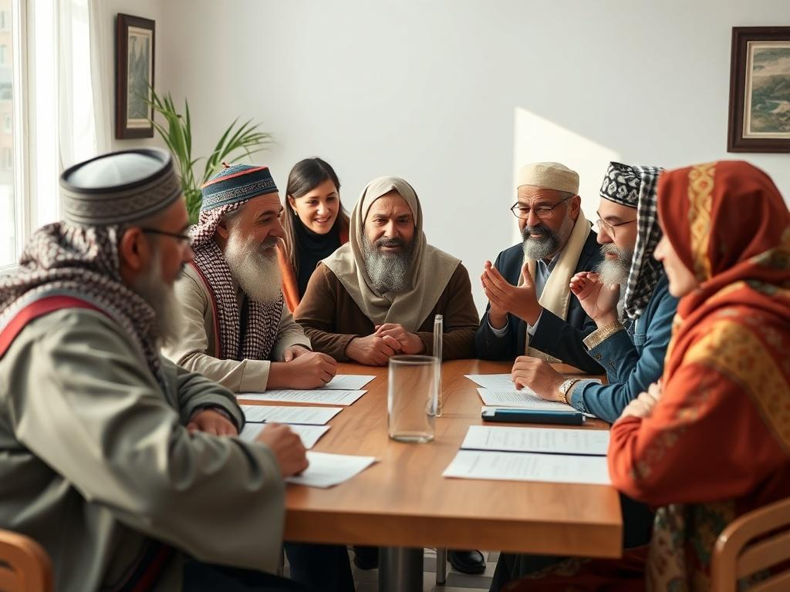

Multi-ReligionElection System

[Home](https://online-voting-system.base44.app/Home)[Elections](https://online-voting-system.base44.app/Elections)[Results](https://online-voting-system.base44.app/Results)[Rules](https://online-voting-system.base44.app/CandidateRules)

[About](https://online-voting-system.base44.app/About)

[Back to Elections](https://online-voting-system.base44.app/Elections)

Active

# Nordic Interfaith Council Election 2025

✝️ Christianity☪️ Islam✡️ Judaism☸️ Buddhism🕉️ Hinduism🪯 Sikhism

## About this Election

Democratic election for representatives of the Nordic Interfaith Council. This election follows the principles of the Multi-Religion Election System, ensuring equal representation for all faith traditions across the Nordic countries.

## Candidates (4)

### Maria Lindberg

Council Representative

✝️ Christianity

Lutheran

Pastor and interfaith dialogue advocate with 20 years of experience in Nordic church leadership.

### Ahmed Hassan

Council Representative

☪️ Islam

Sunni

Imam and community leader promoting peace and understanding between faith communities.

### Rachel Goldstein

Council Representative

✡️ Judaism

Reform

Rabbi dedicated to interfaith cooperation and social justice initiatives.

### Tenzin Norbu

Council Representative

☸️ Buddhism

Tibetan Buddhist

Buddhist monk and meditation teacher focusing on mindfulness and peaceful coexistence.

Candidate Rules & Guidelines

#### 1\. Church-State & Religion-Politics Separation

Addressing the incomplete separation in EU governance

#### 2\. Democracy in All Religions

Transitioning to the Multi-Religion Election System

#### 3\. Unique Conflict Resolution Model

Resolving the 77-year Israel-Palestine conflict

### Election Details

Voting Period

Jan 14, 2025 - Feb 15, 2025

Total Votes

0

Election Type

council

### Election Completed

View the final results above.

Multi-Religion Election System

Where faith and democracy blossom side by side. Nurturing democratic religious reform through inclusive elections.

### Our Mission

- • Interfaith democratic representation

- • Transparent election processes

- • Church-state separation

- • Peaceful conflict resolution

### Learn More

- [Official Website](https://multireligionvalsystem.eu.org/)

- [What is this system?](https://multireligionvalsystem.eu.org/What-is-a-multi-religion-election-system.html)

© 2026 Multi-Religion Election System. Democracy for all faiths.
