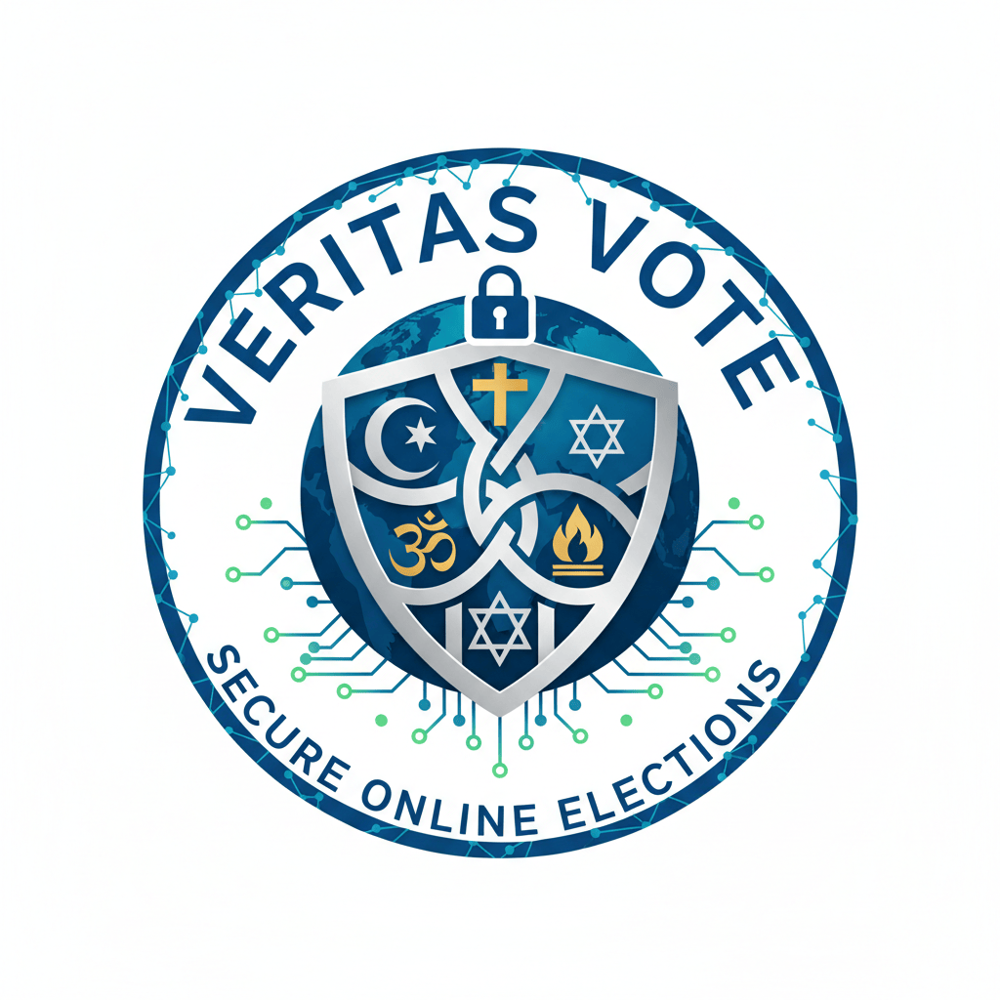

  
  
  
Varför kyrkovalet är så viktigt för fred är att plocka de positiva delarna från detta så att andra länder också kan tillämpa kyrkoval.



Är det Moseboken Mos 12:1 eller Internationella rättsregler som gäller ?

Kyrkovalet tillämpas endast i de nordiska länderna vilket har lett till fred och stabilitet mellan de nordiska grannländerna som tillämpar kyrkoval.

Nedan visas de positiva delarna som kyrkovalet för med sig .

1) Demokrati har införts i alla de nordiska ländernas protestantiska trossamfund.

2) Givit de ungdomar som fyllt 16 år rösträtt så att de får möjlighet att praktisera demokrati två år innan det allmänna valet . Demokratisk utveckling

3) Gjort det möjligt att välja en kvinna till ärkebiskop , jämställdhet.

I jämförelse med de länder som saknar motsvarande val och som befinner sig i krig eller konflikt med grannländerna som exempelvis USA med Kuba, Colombia, Mexico, Venezuela och t o m Grönland. Israel krigar mot grannländerna som Palestina , Syrien , Libanon, Iran med flera. Kriget i Sudan samt konflikter i Somalia, Jemen, Libyen, Nigeria, Myamar, Nordkorea och Sydkorea , Ryssland och Ukraina m fl.

Låt till att börja med Sverige och Norge som varje år delar ut Nobelpriser och tar emot folk från hela världen att i flera seminarier informera om kyrkovalet så att det bli möjligt att separera stat och kyrka och politik från religion .

Samtidigt skall de nordiska länder som tar emot flyktingar informera om kyrkovalets fördelar så att de i sin tur kan informera sina landsmän och andra samtidigt som de informerar om de negativa delarna som ett kyrkoval innebär och på detta sätt får vi igång en ny dialog om kyrkovalsreformen och multireligionvalsystemet .

Reformen, Multireligionvalsystemet, är lämpligt att börja tillämpa i dessa nordiska känder då de redan har kunskap om kyrkovalet . Steg två blir att utvidga tillämpningen så att alla

EU:s medlemsstater förstår kyrkovalet och varför det endast är Danmark, Sverige och Finland inom EU som tillämpar kyrkoval d v s har infört demokrati i sina trossamfund, de protestantiska.

Om kyrkovalet är en konfliktlösningsmodell för de nordiska länderna då är Multireligionvalsystemet en omfattande konfliktlösningsmodell så att den 77 år långa konfliktem mellan Israel och Palestina inte får överlämnas till nästa generation.

Ett väl fungerande internationellt rättssystem behövs därför för att kunna skydda folk i världens alla länder från väpnade konflikter och statligt maktmissbruk och att genom reformen separera staten från kyrkan och religionen från politiken.

Läs vidare om Important Rules for Voters & Religious Communities

EU citizens have their own Christian parties that represent them religiously in the EU Parliament, while other EU citizens belonging to any other religion lack their own religious parties and thus have no representation in the EU Parliament. Therefore

- **a)** No political party is allowed to participate in the Multi-Religion Election System (Multireligionvalsystem)

- **b)** The right to vote applies from the age of 16 for all genders, in the same way as in the church election, so that everyone regardless of religion may practice democracy two years before the general election

[Read more about The 3 Ru](https://online-voting-system.multireligionvalsystem.eu.org)

```
                   The 3 Rules1) The incomplete separation between state and church and religion and politics as Christian EU citizens have their own Christian parties that represent them religiously in the EU Parliament, while other EU citizens belonging to any other religion lack their own religious parties and thus have no representation in the EU Parliament.2) We start from the principle that it is democracy that has given all religious communities freedom of religion, and that democracy be introduced in all religions, without exception. A transition from church elections to a multi-religion election system in those countries that already have church elections, In other countries (USA, UK, China, India, Iran, Israel.....) that do not have similar elections, a multi-religion election system is introduced. ! -The Faith Representatives Chamber (FRC)  is free from the political parties and politicians and replaces the General Synod. The FRC is the highest body of all faiths, it is elected in Multi-Faith Elections. Multi-Religion Elections is the practical application of the Multi-Religion Election System- Multi-Religion Support - The financial model that replaces the SST Foundation and the corresponding party support, but regardless of tax revenue. 3)The unique conflict resolution model is applied so that the 77-year-old conflict between Israel and Palestine can be resolved without delay and prevent it from being passed on to the next generation,
```
