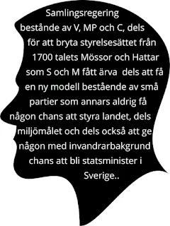

Skall de svenska väljarna efter valet beskyllas av riksdagspartierna för att vara odemokratiska som vill ha regeringskriser och ha religiösa kristna partier i riksdagen och EU-parlamentet ?

För att partierna inte skall få skäl till att skylla på de svenska väljarna gällande valresultatet måste väljarna redan nu markera att det är dags att bilda en samlingsregering före valet för att undvika ytterligare regeringkriser . I kris bildas en samlingsregering !

Väljarna måste veta vad som händer om S och M , L ,KD och C övertalar MP att innan valet bilda en samlingsregering i syfte att b l a dölja de kriser som de har skapat för att dölja sina skandaler ?

Uteslutningsmetod

MP kan avböja på grund av att S och M , L och KD vill satsa på en ohållbar politik som frågan om kärnkraft trots folkomröstningen .

C , MP, V och SD fortfarande utgör majoritet d v s deras mandat räcker inte att fälla dem ..Detta oavsett om det sker före valet eller efter valet och oavsett hur mycket SD filar på svenska folkets tänder , SD:s existens är hotad efter 20 år av manlig dominans och en partiledare som styrt SD under 20 år som en diktator . Om Åkesson byts ut dör SD och försvinner för gott liknande andra partier som NYD, Junilistan, Piratpartiet , Feministiskt initiativ och Folklistan .

Det faktum att Åkesson misslyckas med att genomföra tandvårdsrformen innan M, KD och L tar avstånd från honom och hans parti ?

Kristerssons och Anderssons lämplighet som statsminister är starkt ifrågasatt , att byta ut båda kan vara en lämplig lösning . Kanske det är dags att välja en statsminister med invandrarbakgrund på samma sätt som man efter 100 år lyckades välja en kvinna till statsminister och som lyckades med att styra landet under knappt ett år. En statsminister med invandrarbakgrund som förstår

Israel-Palestina konflikten och varför ingen lyckats lösa den under 77 år och samtidigt reformera kyrkovalet.

Det är osannolikt att Kristersson ansluter sig till (V, L, SD ) och på det sättet bildar en samlingsregering före eller efter valet .

1. Redan nu innan valet bildar han en samlingsregering bestående av (M, S, C, L , KD och MP ) för att b l a rädda L och samtidigt isolera V och SD, och på så sätt slippa gå in i valröreslen med dessa skandaler som ännu ingen velat ta upp till granskning. Frågan är om det är Kristersson elle Andersson som blir statsminister och som kommer att leda samlingsregeringen samt fördelningen av ministerposter.mellan dessa partier.

3. Låter Andersson efter valet bilda en regering bestående av (S, MP, C ) genom att KD och M lägger ner sina röster vilket gör att SD och V med L inte räcker för att fälla Andersson.

C vill ha Andersson som statsminister vilken KD och MP också stöder .

V och SD är ärkefiender och dessa vill varken S eller M ha i regeringen och med motsatta ideologier har de kraftmedel att sätta käppar i hjulet i köpet och L fölorar sitt mandat i riksdagen ?

För att förhindra Andersson att behandla [V som SD har V](https://political-practices-in-exile.multireligionvalsystem.eu.org/YP) en enda utväg att följa nämligen att redan nu ta över oppositionsrollen och bilda en samlingsregering bestående av ( V , MP om C motsätter sig detta) .

Motiveringen är att Sverige befinner sig i en djup kris med många stora skandaler och demokratisk försvagning genom att Sverige tvingades på ett odemokratiskt sätt gå med i NATO men det verkliga hotet kommer inte från Ryssland utan från NATO, USA , det största och mäktigaste NATO- landet.

[Skall Kristersson förråda sina väljare](https://clawdbot.multireligionvalsystem.eu.org/) och sitt parti genom att inte agera demokratiskt som oppositionledare och fälla den tilltänkta statsministern d v s fälla Andersson

Varför fällde de Andersson som statsminister först och sedan efter några dagar ångrade de sig och hon blev vald på nytt?

Det måste vara historiskt att 75 riksdagsledamöter plötsligt lade ner sina röster före valet i en mycket viktig voteringprocess nämligen valet av statsminister vilket ledde till att Andersson blev godkänd .Att demokratin kunde missbrukas på det sättet som ledde till många skandaler vid sidan av NATO- haveriet utan att oppositionen agerade måste betraktas som högförräderi.

Hur som helst det bästa sättet att styra Sverige demokratiskt är att i kris bilda en samlingsregering bestånde av V, MP och C, dels för att bryta styrelsesättet från 1700 talets Mössor och Hattar som S och M fått ärva dels att få en ny modell bestående av små partier som annars aldrig få någon chans att styra landet, dels miljömålet och dels också att ge någon med invandrarbakgrund chans att bli statsminister i Sverige.
