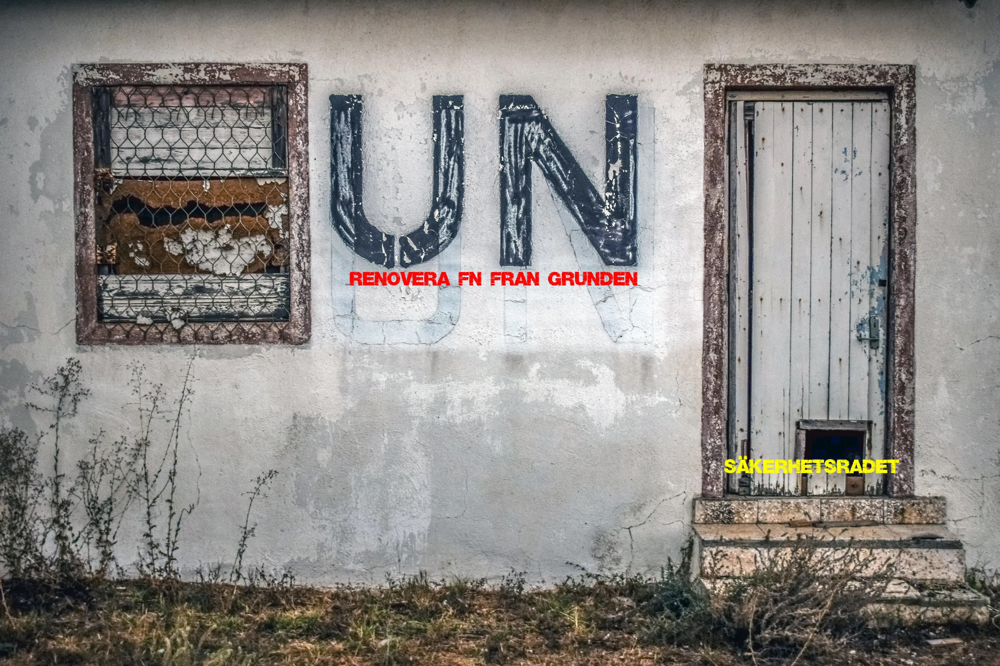

Ja, Trumps hot om att utplåna den iranska civilisationen är att betrakta som ett hot om ett kommande folkmord som FN:s säkerhetsråd kan vara ansvarigt för och därför borde FN utesluta USA från säkerhetsrådet förenat med ett fördömande innan uteslutandet verkställs . Detta gör det också möjligt att få stopp på det pågående folkmordet på palestinier.

Massmedia borde vända sig till de främsta psykiatrikerna för att analysera Trumps beteende .

ENG

Trump's threat to wipe out Iranian civilization is to be considered a threat of an upcoming genocide for which the UN Security Council may be responsible and therefore the UN should expel the US from the Security Council along with a condemnation before the expulsion is carried out. This will also make it possible to stop the ongoing genocide of Palestinians.

The media should turn to the leading psychiatrists to analyze Trump's behavior.
