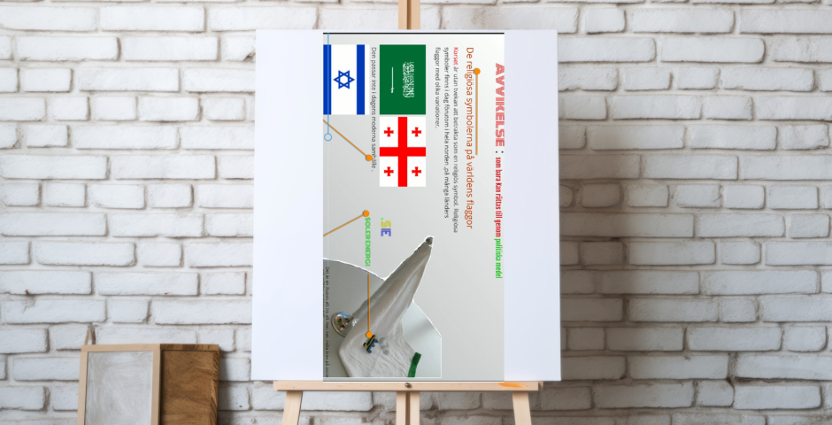
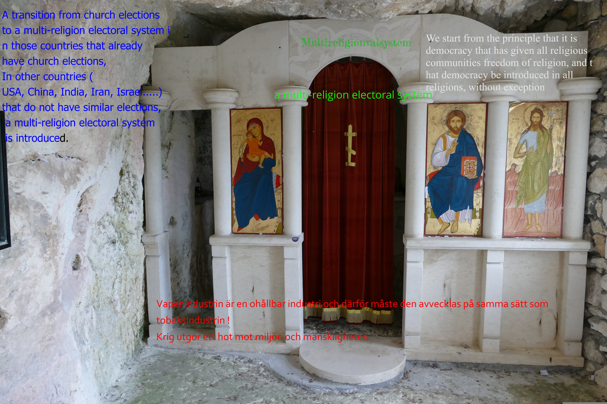

Demokratiska partiet, De Nya Svenskarna (DPNS)
Politisk praxis i exil

Du har ingen rösträtt i det valet som ditt riksdagsparti deltar i [church election](https:/A-multi-religion-election-system.multireligionvalsystem.eu.org),  
kyrkovalet.Hur kommer det sig ?

Har du undrat vilket val som ditt riksdagsparti deltar i nästa år ?

Vad är skillnaden mellan FRC, kyrkomöte, **konklav** , valet av patriark eller parlament ?

Markant skillnad mellan FRC och de andra är att genom de demokratiskt valda representanterna för olika religioner till FRC för att lösa den 78-år långa konflikten mellan Israel och Palestina så att den inte överlämnas till kommande generationer och det har varken kyrkomöte, parlament och **konklav** eller valet av patriark lyckats med att lösa.

Genom FRC kan den konflikten lösas som politiken inte lyckats med att lösa.

Vad är FRC och hur den väljs .läs vidare [https://frc.multireligionvalsystem.eu.org](https://frc.multireligionvalsystem.eu.org/)

### [The Faith Representatives Chamber (FRC)](https://frc.multireligionvalsystem.eu.org/) väljas genom Multireligionvalet som är den praktiska tillämpningen inom Multireligionvalsystemet .

Endast de tre positiva delarna som kyrkovalet har tillämpas i valet av FRC vilket tidigare har nämnts. I kyrkovalet gäller det bara de som tillhör de nordiska kyrkorna (protestantiska trossamfund) som är 16-år och äldre som får rösta i kyrkovalet medan FRC utvidgar rösträtten till att inkludera att alla svenska medborgare som har fyllt 16-år, oavsett religion, får rösta i multireligionvalet.

Till skillnad från kyrkovalet som gör det möjligt för endast en protestantisk kvinna att bli ärkebiskop omfattar Multireligionvalet alla kvinnor, oavsett religion, att ha samma möjlighet att bli vald till den högsta religiösa posten.

Till skillnad från kyrkovalet som bara gör det möjligt att demokratisera endast de protestantiska trossamfunden i de nordiska länderna så demokratiserar Multireligionvalet samtliga religioner utan undantag.

Kyrkovalet tillåter att politikerna och riksdagspartierna deltar i detta. Dessa politiker väljes vid kyrkomötet , detta hindrar separationen mellan stat och kyrka och religion från politik. I motsats till kyrkovalet, förbjuder Multireligionvalet riksdagspartierna att delta i detsamma med målet att fullborda separationen mellan stat och kyrka och religion och politik .Cite This Page

* * *

Cite This Page

Check out (this post) to learn more about the important relationship between church election and Multireligionval.  
[👉 engagera dig nu ! 🤑](https://multireligionvalsystem.eu.org/Om-tillampning-av-MRES-MRE-FRC/)

We start from the principle that it is democracy that has given all religious communities freedom of religion, and that democracy be introduced in all religions, without exception.

A transition from church elections to a multi-religion electoral system in those countries that already have church elections, In other countries (USA, UK, China, India, Iran, Israel.....) that do not have similar elections, a multi-religion electoral system is introduced.

- **The Faith Representatives Chamber (FRC) is free from the political parties and politicians and replaces the General Synod. The FRC is the highest body of all faiths, it is elected in Multi-Faith Elections. [Multi-Religion Elections](https://multireligionvalsystem.eu.org/EU/EU-reform.html) is the practical application of the Multi-Religion Election System.**

\[googleapps domain="docs" dir="forms/d/e/1FAIpQLSfiIGgXMooz9-lnwffzr4yGQsEElSD7fAQyX0YZS1t8MVLgGA/viewform" query="embedded=true" width="640" height="2232" /\]

**Multi-Religion Support - The financial model that replaces the SST Foundation and the corresponding party support, but regardless of tax revenue.**

Reformen innebär att att det proportionella valsystemet som inte fungerar ändras till att varje medlemstat inom den propotionella valsystemtet väljer sina egna antal delegater t ex varje land väljer 21 delegater var. Dessa delegater får ett bestämt mandat av parlamentet d vs vad de skall arbeta för tillsammans med övriga stater, delegationer, vilket gör att det sammanlagt väljs 567 mandat i stället för 720.

Sverige väljer 21 mandat , två från varje riksdagsparti jämte 5 oberoende mandat som representerar alla trossamfund i syfte att införa demokrati i alla trossamfund inom EU , d v s reformera kyrkovalet som innebär att också frågor om frystorkning av döda kroppar i stället för jordbegravning och kremering och att det drivs med solpaneler .

In my work, I explore[  
a multi-religion election system](https://multireligionvalsystem.eu.org/) as a conflict-resolution model in multireligious societies.

[https://app.getbeamer.com/js/beamer-embed.js](https://app.getbeamer.com/js/beamer-embed.js)

Vapenindustrin (försvarsindustrin Elbit Systems Sweden – ett dotterbolag till det israeliska Elbit Systems .Elbit Systems producerar drönare som används av IDF i Gaza ) samt oljeindustrin som också är en ohållbar och miljöförstörande industri och därför måste den avvecklas på samma sätt som tobaksindustrin !

[http://a%20href=](http://a%20href=) 
 <h2>?￯ﾸﾏ Share Your View on Religious Democracy</h2> 
Nordic countries allow 16-year-olds to vote in church elections. What do you think?
 [http://a%20href=](http://a%20href=)
