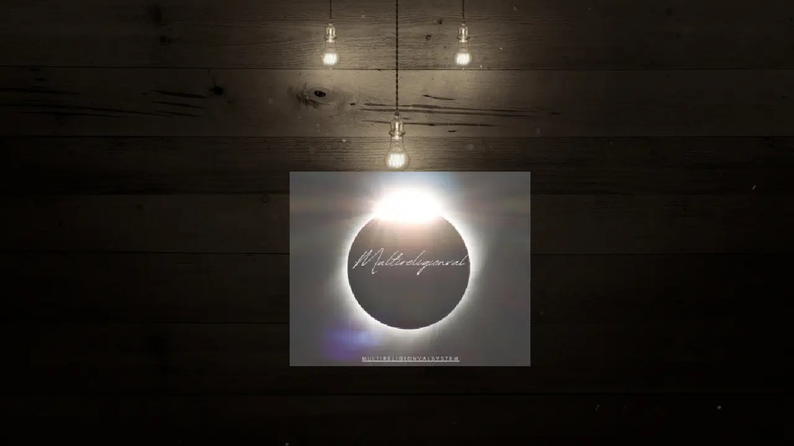

We start from the principle that it is democracy that has given all religious communities freedom of religion, and that democracy be introduced in all religions, without exception.

A transition from church elections to a multi-religion electoral system in those countries that already have church elections, In other countries (USA, UK, China, India, Iran, Israel.....) that do not have similar elections, a multi-religion electoral system is introduced.

- **[The Faith Representatives Chamber (FRC)](https://frc.multireligionvalsystem.eu.org/) is free from the political parties and politicians and replaces the General Synod. The FRC is the highest body of all faiths, it is elected in Multi-Faith Elections. [Multi-Religion Elections](https://multireligionvalsystem.eu.org/) is the practical application of the Multi-Religion Election System.**
    
- **Multi-Religion Support - The financial model that replaces the SST Foundation and the corresponding party support, but regardless of tax revenue.**
    
    `**It’s Time To Talk About Electoral Reform**`
    
- RFP
