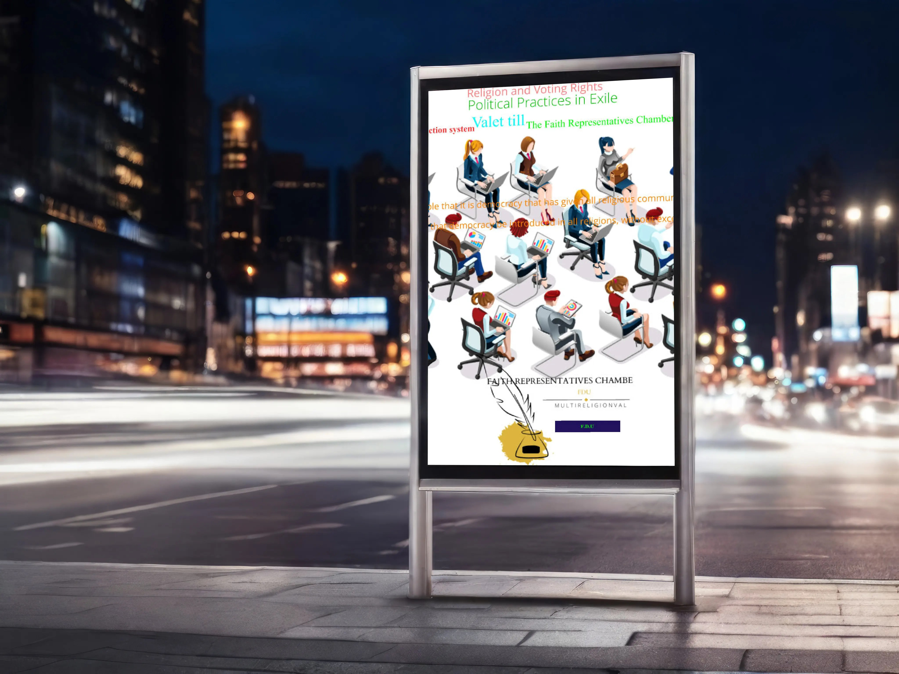

**ccTLDs , blev ekonomiska [guldgruvor till](_wp_link_placeholder)** **[Industriländerna medan fattiggländernas ccTL](_wp_link_placeholder)Ds trots bistånd fortfarande saknar ccTLDs eller har ett vilande ccTLDs på grund av religiösa skäl , styrda av en diktator eller att medborgarna saknar kunskap om betydelsen av ccTLDs och** **utveckling av sina nationella toppdomäner** **.**

**Även länder inom EU saknar en fungerande topdomän,** **ccTLDs, trots att de får EU-bidrag och bistånd . De här länderna valde att betala till militäralliansen NATO i stället för att utveckla sin egen Internet infrastruktur .**

**För att påminna FN och EU m fl om betydelsen av ccTLDs samt de religiösa och svårtolkade symbolerna på nationernas flaggor som vajar vid** **FN:s, EU:s och NATO:s högkvarter behövs en ny flaggdesign!**

**En ny Flaggdesign som skapar en ny Flaggindustri genom dessa förändringar påminner om betydelsen av fattigländernas ccTLDs. Reformen innebär att ersätta de** **de religiösa och svårtolkade symbolerna på nationernas flaggor med sin egen** **ccTLDs.**

Alla symboler på världens flaggor skall ersättas med de egna toppdomänen , ccTLDs,

Den svenska flaggan kommer att se ut som på bilden där korset har ersatts med .**.****S****E** . S är gult och E är blått. Punkten föreslås att vara grön på alla flaggor vilket symboliserar miljön de två bokstäverna SE associerar till Solenergi.

Inlärningssyfte, att barnen i ett tidigt stadium får lära sig alfabetet och miljön från världens flaggor

**samtidigt som** **Flaggindustrin g****er en meningsfull sysselsättning för invandrare och nyanlända flyktingar samt uppmärksammar den viktiga symbolen ccTLDs.**

تم
