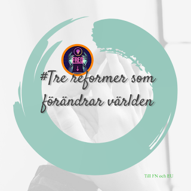
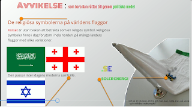

|   How to solve a most complex and controversial issues in the world, The Israel-Palestine conflict by transition from the church election to a multi-religion election system  # Tre reformer som förändrar världen  How to solve a most complex and controversial issues in the world      [Tre reformer som förändrar världen](https://www.multireligionvalsystem.eu.org/Tre-reformer-som-f%C3%B6r%C3%A4ndrar-v%C3%A4rlden/)  Till FN och EU  Följ dessa tre enkla steg , [Trereformer som förändrar världen](https://multireligionvalsystem.eu.org/How-to-solve-a-most-complex-and-controversial-issues-in-the-world/), så kommer garanterat konflikten i Mellanöstern att lösas och övriga delar av världen kommer att få leva i fred .    Religions for peace  \-We start from the principle that it is that has given all religious communities freedom of religion, and that democracy be introduced in all religions, without exception.  - The flags of the nations wave with religious symbols over the EU, UN and NATO therefore it is important to replace the religious symbols with the countries' own ccTLDs.**En ny flaggindustri skapas , arbetstillfällen skapas med i****nlärningssyfte****En ny Flaggdesign som skapar en ny Flaggindustri .Detta påinner  om betydelsen av fattigländernas topdomän , ccTLDs. ,då industriländernas ccTLds fungerar men inte de fattiga ländernas . Det kan beror på krig, religion eller diktatoriskt styrde.****Reformen innebär att man ersätter** **d****e religiösa och svårtolkade symbolerna på nationernas flaggor med sin egen**  **ccTLDs****.** **Den svenska flaggan kommer att se ut som på bilden där korset har ersatts med .****.****S****E** **.** **S** **är gult och** **E** **är blått. Punkten föreslås att vara grön på alla flaggor vilket symboliserar  miljön** **de två bokstäverna SE associerar till Solenergi.**          ****          **[Inlärningssyfte, att barnen i ett tidigt stadium får lära sig alfabetet och miljön från världens flaggor .](https://discover-the-power-of-cctlds.multireligionvalsystem.eu.org/Redesigning-Religious-Symbols-on-Flags-at-the-UN-EU-NATO) S****amtidigt som Flaggindustrin  ger en meningsfull sysselsättning för invandrare och nyanlända flyktingar samt uppmärksammar den viktiga symbolen ccTLDs****En effektiv arbetslöshetsbekämpnings modell som ger en meningsfull syselsättning för inavandrare/flyktingar . Detta sker genom att topdomänen få delegeras till flyktingar/invandrare med hjälp av arbetsförmedlingarna , kommunerna, SIDA och invandrarnas riksorganisationer och trossamfund som redan får statsbidrag från skattemedel.**          **Koordinationen sker genom att SIDA behåller en del av biståndet som går till de länder som inte har fungerande Internetinfrastruktur , topdomän . Den del av biståndet används för delegering av topdomänen . Sudanser både som riksorganisation och trossamfund samarbetar i EXILLANDET får att få sitt lands vilande topdomän att fungera under krig och instabilitet .**          **Detta slöseri med resurser har pågått under en lång period** - **AF och kommunerna har underlag för hur många sudaneser, somalier, syrier, jemeniter, libaneser , ukrainare m fl som har hemvist i de kommunerna och söker jobb . SIDA har underlag om hur mycket bistånd som går till dessa länder varje år, SIDA måste känna till [ccTLDS betydelse](https://discover-the-power-of-cctlds.multireligionvalsystem.eu.org/Fattiga-l%C3%A4ndernas-ccTLDs-discover-the-power-of-ccTLDs) för varje lands internetinfrastrukturs utveckling och som hela Internetinfrastrukturen vilar på.****I varje kommun bildas IT-bolag , ett för varje land , bolaget styrs av** _Internet Society_ **med valda styrelser som representerar exempelvis all sudaneser oavsett religion [.](https://discover-the-power-of-cctlds.multireligionvalsystem.eu.org/Bistand-och-ccTLDs/)** **Flyktingar/invandrare samarbetar fredligt och demokratiskt för en meningsfull sysselsättning , oavsett religion och bakgrund , för dessa tre reformer som kommer att förändra världen .**  Vapenindustrin är en ohållbar industri och därför måste den avvecklas på samma sätt som tobaksindustrin !  **Krig utgör ett hot mot miljön och mänskligheten**/   |    |   _EU_s-_medborgarinitiativ_   |
| --- | --- | --- |

<!--more-->
